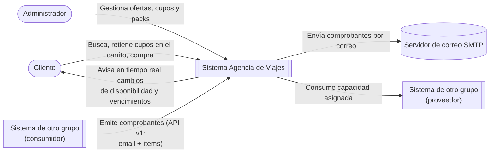
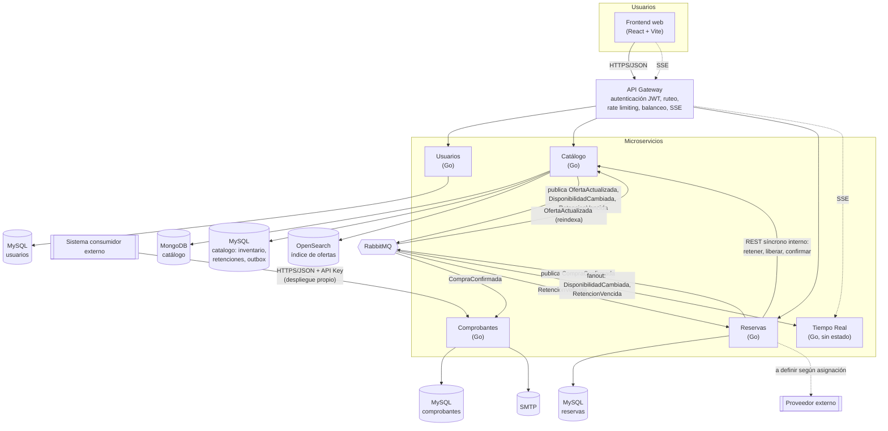
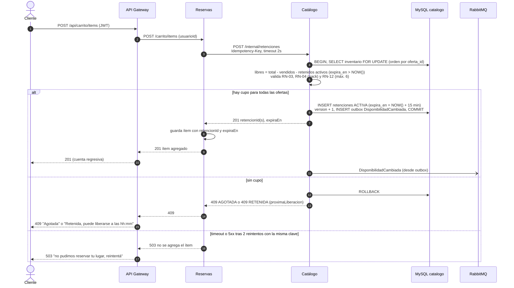
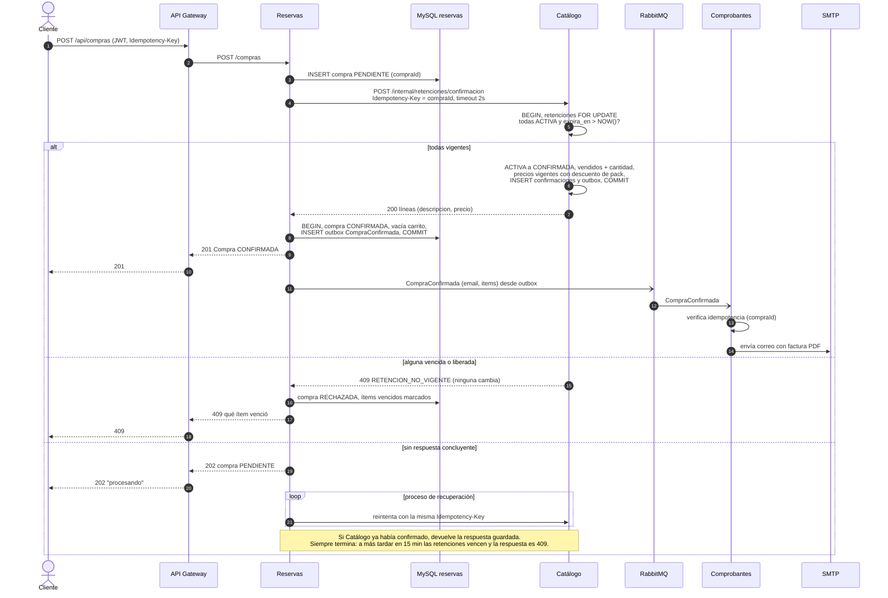
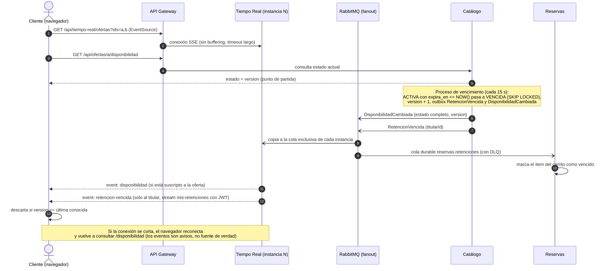

# Arquitectura — Agencia de Viajes

> Versión: Entrega 1 con los cambios de la devolución (2026-10-22). Las decisiones se justifican en [docs/adr/](adr/). El historial de este documento está al final.

## 1. Visión general

El sistema se compone de un **API Gateway** como único punto de entrada y cinco microservicios con propiedad exclusiva de sus datos:

| Servicio | Responsabilidad | Datos que posee | Almacenamiento |
|---|---|---|---|
| **Catálogo** | Qué se vende y cuánto queda: ofertas, packs, búsqueda, **inventario de cupos, retenciones y disponibilidad**. Valida las reglas de pack y calcula precios al confirmar | Ofertas (transporte, estadía, excursión), packs y sus opciones; inventario; retenciones; confirmaciones; outbox | MongoDB (descripciones) + MySQL esquema `catalogo` (inventario, retenciones, outbox) + índice en OpenSearch |
| **Reservas** | Carrito, compras y sus estados; recuperación de compras pendientes | Carritos (cada ítem con `retencionId` y `expiraEn`), compras (`PENDIENTE`, `CONFIRMADA`, `RECHAZADA`), outbox de eventos | MySQL esquema `reservas` |
| **Comprobantes** | Emisión de facturas y envío por correo. **Capacidad publicada** para otros grupos | Comprobantes emitidos, claves de idempotencia, estado de envío | MySQL esquema `comprobantes` |
| **Usuarios** | Registro, autenticación y emisión de tokens JWT | Usuarios, roles, hash de contraseñas | MySQL esquema `usuarios` |
| **Tiempo Real** | Difunde a los navegadores, por SSE, los cambios de disponibilidad y los vencimientos de retención | Ninguno (sin estado) | — |

Cada servicio accede solo a su propia base. Ningún servicio lee la base de otro: la información se obtiene por API o por eventos.

Decisiones principales: límites de servicios en [ADR-014](adr/ADR-014-cupos-en-catalogo-con-retencion.md) (reemplaza a ADR-001) y tiempo real en [ADR-015](adr/ADR-015-disponibilidad-en-tiempo-real.md).

## 2. Diagrama de contexto



## 3. Diagrama de contenedores



> - La API pública de Comprobantes para otros grupos se expone en su propio despliegue en la nube, no a través del gateway del sistema (ver [ADR-008](adr/ADR-008-contrato-propio.md)).
> - Las rutas `/internal/*` de Catálogo **no se publican en el gateway**: solo son accesibles dentro de la red interna de servicios.
> - El consumo del proveedor externo se ubicará en el servicio responsable de la funcionalidad que lo use, una vez que la cátedra asigne la relación.

## 4. Comunicaciones

| Origen → Destino | Tipo | Mecanismo | Propósito |
|---|---|---|---|
| Frontend → Gateway | Síncrona | REST/JSON | Todas las operaciones del usuario |
| Frontend → Gateway → Tiempo Real | Asíncrona (push) | SSE (conexión larga) | Recibir `disponibilidad` y `retencion-vencida` |
| Gateway → Servicios | Síncrona | REST/JSON | Ruteo de solicitudes autenticadas |
| Reservas → Catálogo | Síncrona | REST/JSON interno, timeout 2 s, 2 reintentos con backoff y jitter, idempotente | Retener cupo al agregar al carrito, liberar al quitar, confirmar retenciones al comprar (devuelve precios) |
| Reservas → Comprobantes | Asíncrona | Evento `CompraConfirmada` en RabbitMQ (outbox), cola con DLQ | Emitir comprobante y enviar correo |
| Catálogo → Catálogo (indexador) | Asíncrona | Evento `OfertaActualizada`, cola con DLQ | Mantener sincronizado el índice de búsqueda |
| Catálogo → Tiempo Real | Asíncrona | `DisponibilidadCambiada` y `RetencionVencida` (outbox) en exchange fanout `catalogo.disponibilidad`, cola exclusiva por instancia, **sin DLQ** | Notificar a los navegadores |
| Catálogo → Reservas | Asíncrona | `RetencionVencida` en el mismo fanout, cola durable `reservas.retenciones` con DLQ | Marcar el ítem del carrito como vencido |
| Consumidor externo → Comprobantes | Síncrona | REST/JSON, contrato OpenAPI v1 (1.0.0) | Capacidad publicada |

Detalle y justificación en [ADR-005](adr/ADR-005-comunicacion-entre-servicios.md).

## 5. Flujos principales

### 5.1 Agregar al carrito (retener cupo)



### 5.2 Confirmar compra



### 5.3 Notificación en tiempo real



## 6. Estructura del repositorio

```
.
├── docker-compose.yml        # procedimiento único de puesta en marcha
├── .env.example              # variables sin valores reales
├── gateway/
├── frontend/
├── infra/mysql/init/         # un esquema por servicio
├── services/
│   ├── catalogo/
│   ├── reservas/
│   ├── comprobantes/
│   ├── usuarios/
│   └── tiempo-real/
└── docs/
    ├── ARCHITECTURE.md
    ├── adr/
    ├── contracts/comprobantes/v1/openapi.yaml
    └── devoluciones/         # cambios pedidos por la cátedra y dónde se aplicaron
```

Cada servicio documenta su estructura interna y dependencias en su propio `README.md`.

## 7. Distribución de componentes

- **Local:** todo el sistema se levanta con `docker compose up`.
- **Nube:** el servicio de Comprobantes (capacidad publicada) se despliega con URL pública. Proveedor a definir.
- **Balanceo de carga:** candidato inicial, Catálogo (lectura intensiva y, ahora, también retenciones), con dos o más instancias detrás del gateway. Es posible porque el estado vive en las bases: los bloqueos son de fila en MySQL y el proceso de vencimiento usa `SKIP LOCKED`. Tiempo Real también escala horizontalmente sin coordinación (cada instancia recibe todos los eventos). A confirmar en D12.

## 8. Pendientes de diseño

- D2 Arquitectura interna. Tentativo: Reservas con arquitectura hexagonal (ciclo de vida de carrito y compra, recuperación de pendientes, puertos hacia Catálogo y el broker); Catálogo en capas. Con ADR-014, las reglas de pack (RN-03 a RN-05) y de retención pasaron a Catálogo, así que hay que reevaluar qué servicio aprovecha más cada estilo.
- D4 Consistencia y concurrencia: formalizar lo descrito en ADR-014 (bloqueos, idempotencia, recuperación).
- D6 Búsqueda, D7 Caché, D10 Resiliencia, D11 Observabilidad, D12 Balanceo, D13 Capacidad.
- Tecnología del API Gateway (debe soportar SSE: sin buffering y con timeouts largos por ruta).

## 9. Limitaciones conocidas y deuda técnica

- **Agregar al carrito depende de Catálogo.** Si Catálogo no responde, no se puede agregar (`503`). Es el costo de retener cupo en el momento.
- **Bloqueo de cupo sin compra.** Un usuario puede retener cupo hasta 15 minutos sin comprar. Se acota con un máximo de 6 cupos por oferta y por carrito (supuesto).
- **Compras en `PENDIENTE`.** Si Catálogo no responde al confirmar, la compra queda pendiente hasta que el proceso de recuperación obtenga una respuesta (como máximo, el tiempo de retención).
- **Dos almacenes en Catálogo sin transacción común.** Una oferta puede quedar en MongoDB sin su fila de inventario si falla la segunda escritura; queda visible pero no retenible hasta que una reconciliación la corrija.
- **Tiempo real de mejor esfuerzo.** Los avisos pueden perderse o llegar tarde (hasta el intervalo del proceso de vencimiento, 15 s por defecto, más la latencia del outbox). La fuente de verdad es `GET /api/ofertas/{id}/disponibilidad`.
- **Conexiones largas en el gateway.** Cada navegador con la app abierta mantiene hasta dos conexiones SSE. Con HTTP/1.1, varias pestañas pueden alcanzar el límite de conexiones por dominio.
- **Reloj del navegador.** La cuenta regresiva usa `expiraEn` y el reloj local; si el reloj del cliente está desfasado, puede mostrar un tiempo distinto. La validez real la decide siempre la base de Catálogo.

_Se completará a medida que avance la implementación._

## 10. Historial de este documento

| Fecha | Cambio | Motivo |
|---|---|---|
| 2026-10-09 | Versión inicial (Entrega 1). | — |
| 2026-10-22 | Cupos, retenciones y disponibilidad pasan de Reservas a Catálogo (MySQL esquema `catalogo`). Se agrega el servicio Tiempo Real. Se quitan las sugerencias, la consulta de precios Reservas → Catálogo y el evento `OfertaPublicada`. Se agregan los eventos `DisponibilidadCambiada` y `RetencionVencida`. Se reemplaza el diagrama de confirmación de compra y se agregan los de retención y tiempo real. Se completan las limitaciones conocidas. Se aclara que la API pública de Comprobantes no pasa por el gateway. | Devolución de la Entrega 1 ([ADR-014](adr/ADR-014-cupos-en-catalogo-con-retencion.md), [ADR-015](adr/ADR-015-disponibilidad-en-tiempo-real.md), [ADR-008](adr/ADR-008-contrato-propio.md)). |
