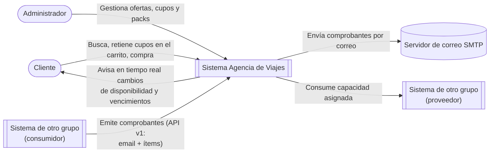
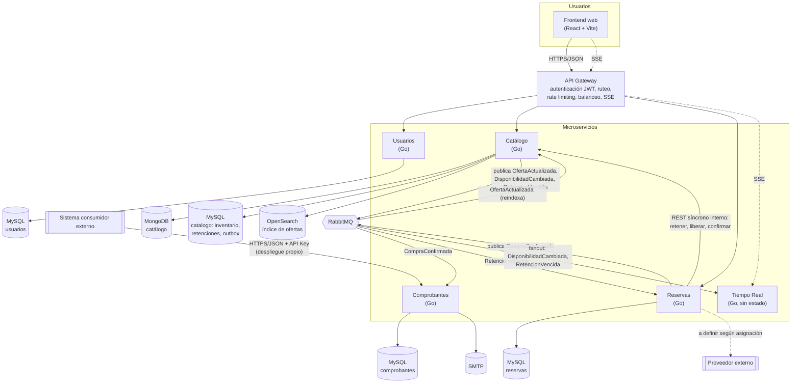
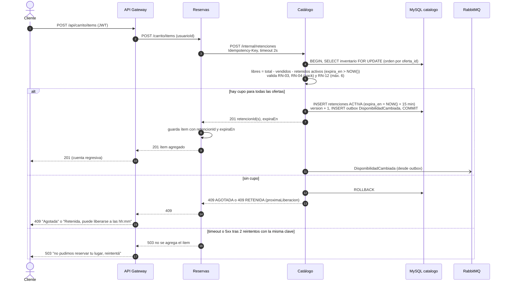
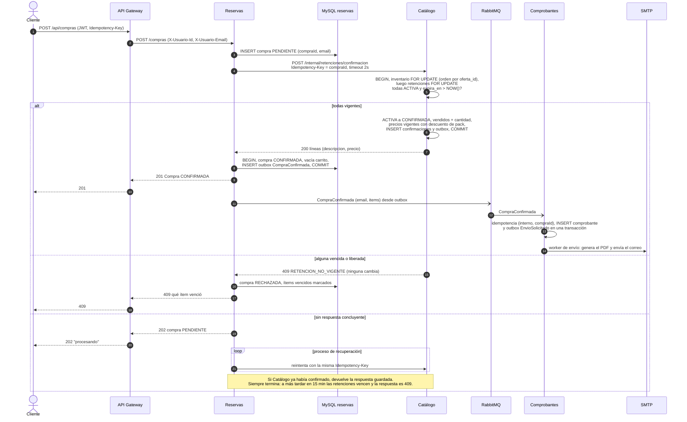
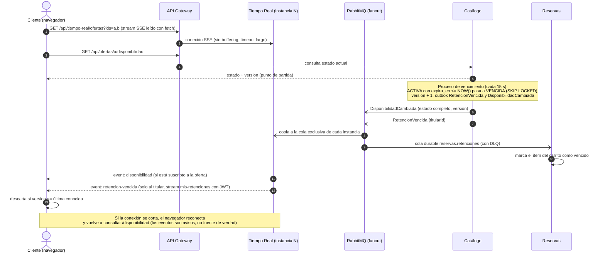

# Arquitectura — Agencia de Viajes

> Versión: Entrega 1 con los cambios de la devolución (2026-10-22). Las decisiones se justifican en [docs/adr/](adr/). El historial de este documento está al final.

## 1. Visión general

El sistema se compone de un **API Gateway** como único punto de entrada y cinco microservicios con propiedad exclusiva de sus datos:

| Servicio | Responsabilidad | Datos que posee | Almacenamiento |
|---|---|---|---|
| **Catálogo** | Qué se vende y cuánto queda: ofertas, packs, búsqueda, **inventario de cupos, retenciones y disponibilidad**. Valida las reglas de pack y calcula precios al confirmar | Ofertas (transporte, estadía, excursión), packs y sus opciones; inventario; retenciones; confirmaciones; outbox | MongoDB (descripciones) + MySQL esquema `catalogo` (inventario, retenciones, outbox) + índice en OpenSearch |
| **Reservas** | Carrito, compras y sus estados; recuperación de compras pendientes | Carritos (cada ítem con `retencionId` y `expiraEn`), compras (`PENDIENTE`, `CONFIRMADA`, `RECHAZADA`), outbox de eventos | MySQL esquema `reservas` |
| **Comprobantes** | Emisión de facturas y envío por correo. **Capacidad publicada** para otros grupos | Comprobantes emitidos, claves de idempotencia por consumidor, estado de envío, outbox | MySQL esquema `comprobantes` |
| **Usuarios** | Registro, autenticación y emisión de tokens JWT | Usuarios, roles, hash de contraseñas | MySQL esquema `usuarios` |
| **Tiempo Real** | Difunde a los navegadores, por SSE, los cambios de disponibilidad y los vencimientos de retención | Ninguno (sin estado) | — |

Cada servicio accede solo a su propia base. Ningún servicio lee la base de otro: la información se obtiene por API o por eventos.

Decisiones principales: límites de servicios en [ADR-014](adr/ADR-014-cupos-en-catalogo-con-retencion.md) (reemplaza a ADR-001), arquitectura interna en [ADR-002](adr/ADR-002-arquitectura-interna.md) y tiempo real en [ADR-015](adr/ADR-015-disponibilidad-en-tiempo-real.md).

**Arquitectura interna ([ADR-002](adr/ADR-002-arquitectura-interna.md)):** Comprobantes, Reservas y Usuarios son **hexagonales** (puertos y adaptadores); Catálogo está organizado **en capas**; Tiempo Real es un conjunto de componentes simples.

**Identidad:** el gateway valida el JWT y propaga a los servicios `X-Usuario-Id`, `X-Usuario-Email` y `X-Usuario-Rol`, después de descartar esos headers si vinieron del cliente.

## 2. Diagrama de contexto



## 3. Diagrama de contenedores



> - La API pública de Comprobantes para otros grupos se expone en su propio despliegue en la nube, no a través del gateway del sistema (ver [ADR-008](adr/ADR-008-contrato-propio.md)).
> - Las rutas `/internal/*` de Catálogo **no se publican en el gateway**: solo son accesibles dentro de la red interna de servicios.
> - El consumo del proveedor externo se ubicará en el servicio responsable de la funcionalidad que lo use, una vez que la cátedra asigne la relación.

## 4. Comunicaciones

| Origen → Destino | Tipo | Mecanismo | Propósito |
|---|---|---|---|
| Frontend → Gateway | Síncrona | REST/JSON | Todas las operaciones del usuario |
| Frontend → Gateway → Tiempo Real | Asíncrona (push) | SSE (conexión larga) | Recibir `disponibilidad` y `retencion-vencida` |
| Gateway → Servicios | Síncrona | REST/JSON | Ruteo de solicitudes autenticadas |
| Reservas → Catálogo | Síncrona | REST/JSON interno, timeout 2 s, 2 reintentos con backoff y jitter, idempotente | Retener cupo al agregar al carrito, liberar al quitar, confirmar retenciones al comprar (devuelve precios) |
| Reservas → Comprobantes | Asíncrona | Evento `CompraConfirmada` en RabbitMQ (outbox), cola con DLQ | Emitir comprobante y enviar correo |
| Comprobantes → Comprobantes (worker de envío) | Asíncrona | Evento `EnvioSolicitado` (outbox) en la cola `comprobantes.envios`, con reintentos y DLQ | Generar el PDF y enviar el correo sin que se pierda si el servicio se cae |
| Catálogo → Catálogo (indexador) | Asíncrona | Evento `OfertaActualizada`, cola con DLQ | Mantener sincronizado el índice de búsqueda |
| Catálogo → Tiempo Real | Asíncrona | `DisponibilidadCambiada` y `RetencionVencida` (outbox) en exchange fanout `catalogo.disponibilidad`, cola exclusiva por instancia, **sin DLQ** | Notificar a los navegadores |
| Catálogo → Reservas | Asíncrona | `RetencionVencida` en el mismo fanout, cola durable `reservas.retenciones` con DLQ | Marcar el ítem del carrito como vencido |
| Consumidor externo → Comprobantes | Síncrona | REST/JSON, contrato OpenAPI v1 (1.0.2) | Capacidad publicada |

Detalle y justificación en [ADR-005](adr/ADR-005-comunicacion-entre-servicios.md).

## 5. Flujos principales

### 5.1 Agregar al carrito (retener cupo)



### 5.2 Confirmar compra



### 5.3 Notificación en tiempo real



## 6. Estructura del repositorio

```
.
├── docker-compose.yml        # procedimiento único de puesta en marcha
├── .env.example              # variables sin valores reales
├── go.work                   # une los módulos Go (cada servicio + pkg) para el editor y los tests
├── pkg/                      # módulo Go compartido: logs, correlación y trazas
├── gateway/
├── frontend/
├── infra/mysql/init/         # un esquema y un usuario por servicio
├── services/
│   ├── catalogo/
│   ├── reservas/
│   ├── comprobantes/
│   ├── usuarios/
│   └── tiempo-real/
└── docs/
    ├── ARCHITECTURE.md
    ├── adr/
    ├── contracts/comprobantes/v1/openapi.yaml
    └── devoluciones/         # cambios pedidos por la cátedra y dónde se aplicaron
```

Cada servicio documenta su estructura interna y dependencias en su propio `README.md`.

## 7. Distribución de componentes

- **Local:** todo el sistema se levanta con `docker compose up`.
- **Nube:** el servicio de Comprobantes (capacidad publicada) se despliega con URL pública en una VM con Docker Compose y Caddy (HTTPS). Procedimiento en [DESPLIEGUE.md](DESPLIEGUE.md).
- **Balanceo de carga:** Catálogo corre en dos instancias detrás del Gateway. El estado vive en las bases: los bloqueos son de fila en MySQL y el proceso de vencimiento usa `SKIP LOCKED`. El round robin, la caída, la alerta y la recuperación se verificaron localmente (ADR-012 y [ensayo](ensayos/2026-11-10-balanceo-gateway.md)). Tiempo Real también escala horizontalmente sin coordinación: cada instancia recibe todos los eventos por su cola exclusiva.

## 8. Pendientes de diseño

Las trece decisiones obligatorias (D1 a D13) están tomadas, implementadas y validadas con evidencia sobre el sistema (ver el [índice de ADR](adr/README.md)). Quedan como mejoras, fuera del alcance de la entrega:

- **D13 Capacidad:** el escenario B3 (vencimiento masivo de retenciones) no se midió, y las pruebas de carga se hicieron sin el gateway delante, así que su costo no está medido ([ADR-013](adr/ADR-013-capacidad-y-costos.md)).
- **D11 Observabilidad:** métricas de negocio, de colas y del outbox, y un span propio del publicador de outbox ([ADR-011](adr/ADR-011-observabilidad.md)).
- **Comprobantes:** operación administrativa para reintentar el envío de un comprobante `FALLIDO` (acción de mejora de [ADR-010](adr/ADR-010-resiliencia.md)).

## 9. Limitaciones conocidas y deuda técnica

- **Agregar al carrito depende de Catálogo.** Si Catálogo no responde, no se puede agregar (`503`). Es el costo de retener cupo en el momento.
- **Bloqueo de cupo sin compra.** Un usuario puede retener cupo hasta 15 minutos sin comprar. Se acota con un máximo de 6 cupos por oferta y por carrito (supuesto).
- **Compras en `PENDIENTE`.** Si Catálogo no responde al confirmar, la compra queda pendiente hasta que el proceso de recuperación obtenga una respuesta (como máximo, el tiempo de retención).
- **Dos almacenes en Catálogo sin transacción común.** El alta de una oferta escribe primero el inventario en MySQL y después la descripción en MongoDB. Si falla la segunda escritura, queda un inventario sin oferta: no se ve ni se puede retener, porque retener lee la oferta de MongoDB ([ADR-004](adr/ADR-004-consistencia-y-concurrencia.md)).
- **Tiempo real de mejor esfuerzo.** Los avisos pueden perderse o llegar tarde (hasta el intervalo del proceso de vencimiento, 15 s por defecto, más la latencia del outbox). La fuente de verdad es `GET /api/ofertas/{id}/disponibilidad`.
- **Conexiones largas en el gateway.** Cada navegador con la app abierta mantiene hasta dos conexiones SSE. Con HTTP/1.1, varias pestañas pueden alcanzar el límite de conexiones por dominio.
- **Reloj del navegador.** La cuenta regresiva usa `expiraEn` y el reloj local; si el reloj del cliente está desfasado, puede mostrar un tiempo distinto. La validez real la decide siempre la base de Catálogo.
- **Contención en ofertas muy demandadas.** Todas las operaciones sobre una misma oferta se serializan en su fila de inventario (regla de bloqueo de ADR-014). Medido: con 200 personas a la vez sobre una oferta de 50 cupos se vendieron exactamente 50, pero retener tardó hasta ~3,5 s para los últimos de la fila ([ADR-013](adr/ADR-013-capacidad-y-costos.md#resultados-del-escenario-b)).
- **Correo "al menos una vez".** Si el worker de Comprobantes se cae después de que el servidor de correo aceptó el mensaje y antes de marcar `ENVIADO`, al reintentar el correo se envía de nuevo. Nunca se emite un segundo comprobante, pero en ese caso puntual el cliente puede recibir el mismo correo dos veces. Con SMTP no se puede garantizar "exactamente una vez"; la ventana es de milisegundos.
- **Numeración con huecos.** El número de comprobante sale de una columna `AUTO_INCREMENT`; una inserción que falla (por ejemplo, por clave de idempotencia repetida) consume un número y deja un hueco en la secuencia.
- **Rate limit por instancia.** El límite de 60 solicitudes por minuto de la API de Comprobantes se cuenta en memoria de cada instancia; con varias instancias, el límite efectivo se multiplica.
- **Búsqueda eventualmente consistente.** Un cambio de oferta tarda alrededor de un segundo en aparecer en la búsqueda (medido: p95 1,1 s; objetivo ≤ 5 s). Si OpenSearch cae, la búsqueda responde `503` y el resto del flujo sigue; si la caída dura más de ~50 s, los cambios de ese lapso van a la DLQ y hay que reconstruir el índice (`POST /internal/busqueda/reconstruccion`, no es automático) ([ADR-006](adr/ADR-006-busqueda.md#revisiones)).
- **OpenSearch en un solo nodo, sin réplicas.** Es lo primero que se satura en las lecturas (~3,8 núcleos a 1000 búsquedas por segundo) y su caída deja sin búsqueda.
- **La búsqueda no muestra disponibilidad.** Una oferta agotada aparece en los resultados; el cliente ve el estado real al abrir el detalle ([ADR-006](adr/ADR-006-busqueda.md)).
- **Paginación acotada.** La búsqueda llega como máximo a la página 50 (1000 resultados); más allá hay que refinar los filtros.
- **Detalle cacheado desactualizado.** Por una carrera entre lectura y modificación, el detalle de una oferta puede mostrar un dato viejo, en general por alrededor de un segundo y como máximo 10 minutos (TTL). El precio que se cobra nunca sale de la caché ([ADR-007](adr/ADR-007-cache.md)).
- **Envíos `FALLIDO` sin reintento.** Un comprobante cuyo correo agotó los reintentos queda `FALLIDO`; reprocesar su mensaje de la DLQ no reenvía el correo. Falta una operación de reintento ([ADR-010](adr/ADR-010-resiliencia.md)).
- **MySQL compartido es el límite del flujo de compra.** Catálogo, Reservas y Comprobantes usan el mismo servidor (con esquemas y usuarios separados). En la prueba de carga, a 112 compras por segundo MySQL usó ~5 núcleos y comprar tardó p95 ~2 s. Separar el servidor de Catálogo no requiere cambiar código ([ADR-013](adr/ADR-013-capacidad-y-costos.md#alternativas-de-escalado)).
- **Publicador del outbox limitado a ≈ 40-45 eventos por segundo** (Comprobantes y Reservas). Publica y marca de a un evento, ≈ 25 ms cada uno. Por encima de esa tasa sostenida las facturas se atrasan, sin perderse: tras 2 minutos a 112 compras por segundo, llegaron en los ~5 minutos siguientes. Arreglo: confirmaciones en bloque y un solo `UPDATE` por lote ([ADR-013](adr/ADR-013-capacidad-y-costos.md#alternativas-de-escalado)).
- **El corte de la caché traslada el pico a MongoDB.** Si Redis falla 5 veces seguidas, Catálogo deja de consultarlo 30 s y todas las lecturas van a MongoDB de golpe. Con la máquina sin memoria, eso agotó el pool de conexiones de MongoDB (0,02 % de `503`) ([ADR-007](adr/ADR-007-cache.md)).
- **Trazas en memoria.** Jaeger guarda las trazas en memoria, limitado a 20 000. Sin el límite, una prueba de carga lo llevó a 5,5 GB y dejó sin memoria al resto ([POSTMORTEM](POSTMORTEM.md)).
- **Despliegue en una sola máquina virtual** ([DESPLIEGUE.md](DESPLIEGUE.md)). Es un único punto de falla, y las copias de seguridad y las actualizaciones de la capacidad publicada las operamos nosotros. Prometheus, Grafana y Jaeger corren solo en el entorno local.
- **Recortes de alcance** (plan de desarrollo, §3.2): los packs son mínimos (descuento fijo, se agregan todo o nada). Tiempo Real (bonus, [ADR-015](adr/ADR-015-disponibilidad-en-tiempo-real.md)) está implementado; la consulta de la disponibilidad cada 15 s queda de respaldo en el detalle por si el servicio no responde. B3 (vencimiento masivo de retenciones) no se midió.

**Resuelto:** el arranque en frío de Comprobantes con el volumen de MySQL vacío, con healthcheck de MySQL por TCP y `restart: on-failure` (2026-11-07). Comprobantes no reintenta la conexión inicial en el código: si falla, Docker lo reinicia (Catálogo y Reservas sí reintentan).

## 10. Historial de este documento

| Fecha | Cambio | Motivo |
|---|---|---|
| 2026-10-09 | Versión inicial (Entrega 1). | — |
| 2026-10-22 | Cupos, retenciones y disponibilidad pasan de Reservas a Catálogo (MySQL esquema `catalogo`). Se agrega el servicio Tiempo Real. Se quitan las sugerencias, la consulta de precios Reservas → Catálogo y el evento `OfertaPublicada`. Se agregan los eventos `DisponibilidadCambiada` y `RetencionVencida`. Se reemplaza el diagrama de confirmación de compra y se agregan los de retención y tiempo real. Se completan las limitaciones conocidas. Se aclara que la API pública de Comprobantes no pasa por el gateway. | Devolución de la Entrega 1 ([ADR-014](adr/ADR-014-cupos-en-catalogo-con-retencion.md), [ADR-015](adr/ADR-015-disponibilidad-en-tiempo-real.md), [ADR-008](adr/ADR-008-contrato-propio.md)). |
| 2026-10-22 | Se agrega la arquitectura interna (ADR-002) y los headers de identidad del gateway. El diagrama de confirmación muestra el bloqueo del inventario antes de las retenciones, el email guardado en la compra y el outbox de Comprobantes. Se agrega la comunicación interna `EnvioSolicitado`. Se quita D2 de pendientes y se suman cuatro limitaciones. | Revisión interna del diseño ([ADR-002](adr/ADR-002-arquitectura-interna.md), revisiones de [ADR-014](adr/ADR-014-cupos-en-catalogo-con-retencion.md#revisiones), [ADR-005](adr/ADR-005-comunicacion-entre-servicios.md#revisiones) y [ADR-008](adr/ADR-008-contrato-propio.md#revisiones)). |
| 2026-10-23 | Pendientes de diseño: se quitan D6, D7 y D10 (decididas) y se detalla qué falta de D9, D11, D12, D13 y de la validación de D1, D3 y D5. Se suman siete limitaciones (búsqueda eventualmente consistente y sin disponibilidad, paginación acotada, caché del detalle, envíos `FALLIDO`, capacidad sin medir, despliegue en una sola VM). | Entrega 2: [ADR-006](adr/ADR-006-busqueda.md), [ADR-007](adr/ADR-007-cache.md), [ADR-009](adr/ADR-009-consumo-del-proveedor.md), [ADR-010](adr/ADR-010-resiliencia.md), [ADR-013](adr/ADR-013-capacidad-y-costos.md) y revisión de [ADR-005](adr/ADR-005-comunicacion-entre-servicios.md#revisiones). |
| 2026-10-23 | Validación de D1, D3 y D5 sobre Comprobantes y resultados de la prueba de carga del escenario A. Pendientes y limitaciones actualizados: arranque en frío, capacidad medida solo en Comprobantes y límite del publicador del outbox. | Entrega 2: evidencia en ejecución (revisiones de [ADR-003](adr/ADR-003-persistencia.md#revisiones), [ADR-005](adr/ADR-005-comunicacion-entre-servicios.md#revisiones), [ADR-014](adr/ADR-014-cupos-en-catalogo-con-retencion.md#revisiones), [ADR-010](adr/ADR-010-resiliencia.md#revisiones) y [ADR-013](adr/ADR-013-capacidad-y-costos.md#revisiones)). |
| 2026-11-10 | Limitaciones con los valores medidos (búsqueda, caché, oferta caliente, MySQL compartido, publicador del outbox), OpenSearch en un nodo, trazas en memoria y recortes de alcance. Se marca resuelto el arranque en frío. El despliegue en la nube apunta a [DESPLIEGUE.md](DESPLIEGUE.md). D13 actualizado. | Presentación grupal: búsqueda implementada, escenario B medido y despliegue preparado ([ADR-006](adr/ADR-006-busqueda.md#revisiones), [ADR-007](adr/ADR-007-cache.md), [ADR-013](adr/ADR-013-capacidad-y-costos.md#resultados-del-escenario-b)). |
| 2026-11-10 | Se actualiza el estado de D11/D12: dashboard y alertas aprovisionados; Gateway integrado con las dos instancias de Catálogo y ensayo de caída, alerta y recuperación documentado. Quedan como pendientes la alerta global de 5xx bajo carga y métricas adicionales de negocio. | Integración del Gateway/observabilidad con Catálogo; evidencia en [ensayo](ensayos/2026-11-10-balanceo-gateway.md) y [ADR-012](adr/ADR-012-balanceo-de-carga.md). |
| 2026-11-11 | Pendientes de diseño: D4 (ADR-004), D9 y la validación de D1, D3 y D5 ya están resueltas; quedan B3, la medición con el gateway delante, métricas de negocio y el reintento de envíos `FALLIDO`. Usuarios figura como hexagonal (ADR-002). Se corrige la limitación de los dos almacenes de Catálogo: el inventario se escribe primero. | Coherencia con el código y con los ADR al cierre. |
