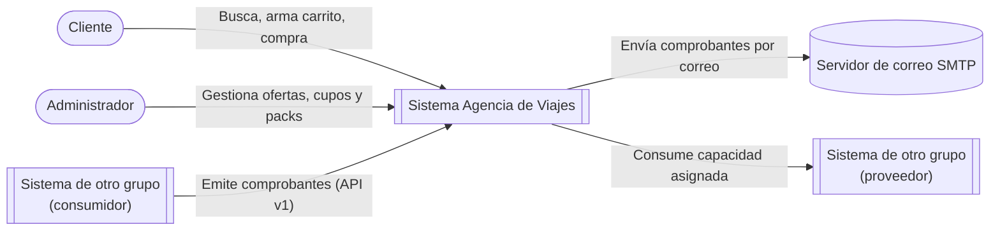
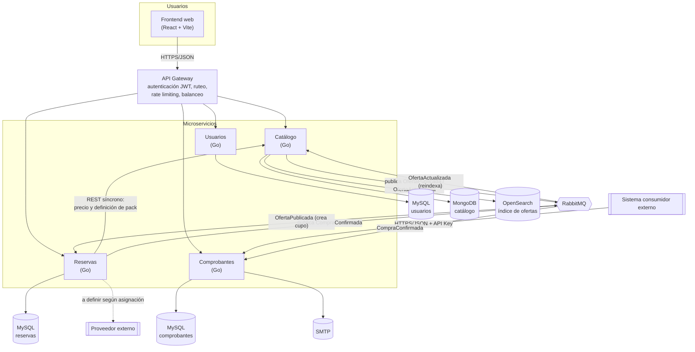

# Arquitectura — Agencia de Viajes

> Versión: Entrega 1 (diseño preliminar). Las decisiones se justifican en [docs/adr/](adr/).

## 1. Visión general

El sistema se compone de un **API Gateway** como único punto de entrada y cuatro microservicios con propiedad exclusiva de sus datos:

| Servicio | Responsabilidad | Datos que posee | Almacenamiento |
|---|---|---|---|
| **Catálogo** | Descripción de ofertas y packs, búsqueda y sugerencias | Ofertas (transporte, estadía, excursión), packs y sus opciones | MongoDB + índice en OpenSearch |
| **Reservas** | Carrito, compras, estados y **cupos disponibles** | Carritos, compras, ítems de compra, inventario de cupos, outbox de eventos | MySQL |
| **Comprobantes** | Emisión de facturas y envío de correos. **Capacidad publicada** para otros grupos | Comprobantes emitidos, claves de idempotencia, registro de notificaciones | MySQL (esquema propio) |
| **Usuarios** | Registro, autenticación y emisión de tokens JWT | Usuarios, roles, hash de contraseñas | MySQL (esquema propio) |

Cada servicio accede solo a su propia base. Ningún servicio lee la base de otro: la información se obtiene por API o por eventos.

## 2. Diagrama de contexto



## 3. Diagrama de contenedores



> El consumo del proveedor externo se ubicará en el servicio responsable de la funcionalidad que lo use, una vez que la cátedra asigne la relación.

## 4. Comunicaciones

| Origen → Destino | Tipo | Mecanismo | Propósito |
|---|---|---|---|
| Frontend → Gateway | Síncrona | REST/JSON | Todas las operaciones del usuario |
| Gateway → Servicios | Síncrona | REST/JSON | Ruteo de solicitudes autenticadas |
| Reservas → Catálogo | Síncrona | REST/JSON con timeout y reintentos | Obtener precio vigente y definición de pack al confirmar |
| Reservas → Comprobantes | Asíncrona | Evento `CompraConfirmada` en RabbitMQ | Emitir comprobante y enviar correo |
| Catálogo → Reservas | Asíncrona | Evento `OfertaPublicada` | Crear el registro de cupo de la nueva oferta |
| Catálogo → Catálogo (indexador) | Asíncrona | Evento `OfertaActualizada` | Mantener sincronizado el índice de búsqueda |
| Consumidor externo → Comprobantes | Síncrona | REST/JSON, contrato OpenAPI v1 | Capacidad publicada |

Detalle y justificación en [ADR-005](adr/ADR-005-comunicacion-entre-servicios.md).

## 5. Flujo principal: confirmar compra

```mermaid
sequenceDiagram
    autonumber
    actor C as Cliente
    participant GW as API Gateway
    participant R as Reservas
    participant CAT as Catálogo
    participant DB as MySQL Reservas
    participant MQ as RabbitMQ
    participant CP as Comprobantes
    participant M as SMTP

    C->>GW: POST /compras (JWT)
    GW->>R: POST /compras
    R->>CAT: GET precios y definición de pack (timeout 2s)
    CAT-->>R: precios vigentes
    R->>R: valida RN-03, RN-04, calcula total
    R->>DB: BEGIN; descuenta cupos condicionados (cupo >= cantidad);<br/>inserta compra + evento en outbox; COMMIT
    R-->>GW: 201 Compra CONFIRMADA
    GW-->>C: 201
    R->>MQ: publica CompraConfirmada (desde outbox)
    MQ->>CP: CompraConfirmada
    CP->>CP: verifica idempotencia (compraId)
    CP->>M: envía correo con factura PDF
```

## 6. Estructura del repositorio

```
.
├── docker-compose.yml        # procedimiento único de puesta en marcha
├── .env.example              # variables sin valores reales
├── gateway/
├── frontend/
├── services/
│   ├── catalogo/
│   ├── reservas/
│   ├── comprobantes/
│   └── usuarios/
└── docs/
    ├── ARCHITECTURE.md
    ├── adr/
    └── contracts/comprobantes/v1/openapi.yaml
```

Cada servicio documenta su estructura interna y dependencias en su propio `README.md`.

## 7. Distribución de componentes

- **Local:** todo el sistema se levanta con `docker compose up`.
- **Nube:** el servicio de Comprobantes (capacidad publicada) se despliega con URL pública. Proveedor a definir.
- **Balanceo de carga:** candidato inicial, Catálogo (servicio de lectura intensiva) con dos o más instancias detrás del gateway. A confirmar en D12.

## 8. Pendientes de diseño

- D2 Arquitectura interna (tentativo: Reservas con arquitectura hexagonal por la riqueza de sus reglas; Catálogo en capas).
- D6 Búsqueda, D7 Caché, D10 Resiliencia, D11 Observabilidad, D12 Balanceo, D13 Capacidad.
- Tecnología del API Gateway.

## 9. Limitaciones conocidas y deuda técnica

_Se completará a medida que avance la implementación._
