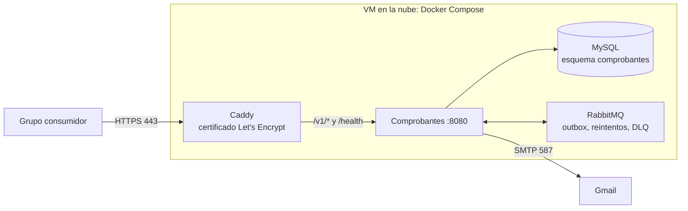

# Despliegue de la API de Comprobantes

La capacidad propia (API de Emisión de Comprobantes, [ADR-008](adr/ADR-008-contrato-propio.md)) corre en una VM en la nube con URL pública y HTTPS, para que la use el grupo consumidor. El resto del sistema se levanta localmente con `docker compose` (README).

| Dato | Valor |
|---|---|
| URL pública | https://68-211-124-251.sslip.io |
| Proveedor y VM | Azure for Students, Chile Central, Standard B2als v2 (2 vCPU, 4 GB), Ubuntu 24.04. Desplegado el 2026-11-10 |
| Responsable | Arribillaga |
| Archivos | [`deploy/comprobantes/`](../deploy/comprobantes/) |

## Qué se despliega



- **Solo Caddy publica puertos**: 80 (para obtener el certificado y redirigir a HTTPS) y 443. MySQL, RabbitMQ y el 8080 del servicio no salen de la VM.
- Caddy publica únicamente `/v1/*` y `/health`. `/metrics` no se expone.
- Es una **versión reducida** del `docker-compose.yml` principal: sin observabilidad (Prometheus, Grafana, Jaeger) ni los demás servicios. Las trazas se desactivan solas sin `OTEL_EXPORTER_OTLP_ENDPOINT`; los logs quedan en `docker compose logs` y en la tabla `app_logs`.
- Mismos mecanismos que en local: idempotencia por `Idempotency-Key`, outbox, reintentos del correo a los 5, 15 y 30 s y DLQ ([ADR-010](adr/ADR-010-resiliencia.md)).

## 1. Crear la VM

Cualquiera de estas alcanza. **Mínimo 1 GB de RAM con 2 GB de swap, o 2 GB de RAM.**

| Proveedor | Opción | Costo |
|---|---|---|
| Oracle Cloud Free Tier | VM.Standard.A1.Flex (ARM), 1 OCPU, 6 GB | Gratis |
| DigitalOcean | Droplet Basic 1 GB / 2 GB | USD 6 / 12 por mes (crédito de estudiante) |
| AWS Lightsail | Instancia de 1 GB / 2 GB | USD 5 / 10 por mes (3 meses gratis) |

- Sistema: **Ubuntu 24.04**.
- Acceso por SSH con clave.
- **Firewall del proveedor** (Security List en Oracle, Firewall en DigitalOcean o Lightsail): abrir solo **22, 80 y 443** de entrada.
- Anotar la **IP pública**.

## 2. Preparar el servidor

```bash
ssh ubuntu@<IP>

# Docker y el plugin compose
curl -fsSL https://get.docker.com | sudo sh
sudo usermod -aG docker $USER && newgrp docker

# Swap de 2 GB (si la VM tiene 1 GB de RAM)
sudo fallocate -l 2G /swapfile && sudo chmod 600 /swapfile
sudo mkswap /swapfile && sudo swapon /swapfile
echo '/swapfile none swap sw 0 0' | sudo tee -a /etc/fstab
```

**Solo en Oracle Cloud:** la imagen de Ubuntu trae reglas de iptables que bloquean el 80 y el 443 aunque estén abiertos en la Security List:

```bash
sudo iptables -I INPUT 6 -m state --state NEW -p tcp --dport 80 -j ACCEPT
sudo iptables -I INPUT 6 -m state --state NEW -p tcp --dport 443 -j ACCEPT
sudo netfilter-persistent save
```

## 3. Configurar y levantar

```bash
git clone <URL del repositorio> agencia && cd agencia/deploy/comprobantes
cp .env.example .env
nano .env
```

En el `.env`:

- **`DOMINIO`**: sin dominio propio, la IP con guiones más `.sslip.io`. Por ejemplo, para la IP `203.0.113.10` es `203-0-113-10.sslip.io`. sslip.io resuelve ese nombre a la IP, y con eso Caddy obtiene un certificado válido.
- **Contraseñas propias** para MySQL y RabbitMQ, distintas de las del entorno local.
- **`SMTP_PASSWORD`**: la contraseña de aplicación de Gmail del grupo. Se pide por privado y nunca va al repositorio.

```bash
docker compose up -d --build
docker compose ps          # todo "healthy" / "running"
docker compose logs -f caddy comprobantes
```

La primera vez, Caddy tarda unos segundos en obtener el certificado.

## 4. Verificar desde afuera

Desde otra máquina, no desde la VM:

```bash
URL=https://<DOMINIO>

curl -s $URL/health
# {"estado":"ok",...}

# Pedir una API Key: llega por correo al email indicado
curl -s -X POST $URL/v1/api-keys -H "Content-Type: application/json" \
  -d '{"grupo":"prueba-despliegue","email":"<un email propio>"}'

# Emitir un comprobante con esa clave: llega la factura en PDF al email
curl -s -X POST $URL/v1/comprobantes \
  -H "Content-Type: application/json" -H "X-API-Key: <clave recibida>" \
  -H "Idempotency-Key: $(uuidgen)" \
  -d '{"email":"<un email propio>","items":[{"descripcion":"Prueba de despliegue","precio":1000}]}'

# /metrics no está publicado
curl -s -o /dev/null -w "%{http_code}\n" $URL/metrics   # 404
```

Si `POST /v1/api-keys` responde `503`, casi siempre es el correo: la clave se envía por email en el momento, así que con credenciales SMTP inválidas no se puede registrar. Revisar `docker compose logs comprobantes` y las variables `SMTP_*`.

Probado en local el 2026-11-10 con `DOMINIO=localhost` (Caddy usa un certificado propio para `localhost`): los cuatro contenedores sanos, `/health` por HTTPS, `/metrics` en `404`, HTTP redirige a HTTPS (`308`) y `/v1` sin clave en `401`.

Verificado en la nube el 2026-11-10 desde fuera de la VM: `/health` responde por HTTPS con certificado de Let's Encrypt, HTTP redirige a HTTPS (`308`), `/metrics` en `404`, el puerto 8080 no responde desde afuera, `POST /v1/api-keys` en `202` con el correo recibido, `POST /v1/comprobantes` en `201` (reintento con la misma `Idempotency-Key` en `200`) y el envío terminó `ENVIADO`.

## 5. Publicar la URL

Al cambiar de VM o de dominio, actualizar la URL `https://<DOMINIO>` en:

- [`docs/contracts/comprobantes/v1/openapi.yaml`](contracts/comprobantes/v1/openapi.yaml) (`servers`)
- [`docs/contracts/README.md`](contracts/README.md)
- [`docs/contracts/comprobantes/v1/GUIA-INTEGRACION.md`](contracts/comprobantes/v1/GUIA-INTEGRACION.md) (también el contacto)
- La tabla de arriba y el README principal

Después, mandarle al grupo consumidor la URL y el enlace a la guía de integración.

## Operación

| Tarea | Comando (en `deploy/comprobantes`) |
|---|---|
| Ver logs | `docker compose logs -f comprobantes` |
| Actualizar a lo último de `main` | `git pull && docker compose up -d --build comprobantes` |
| Mensajes en la DLQ | `docker compose exec rabbitmq rabbitmqctl list_queues name messages \| grep dlq` |
| Reiniciar todo | `docker compose restart` |
| Respaldo de la base | `docker compose exec mysql sh -c 'mysqldump -uroot -p"$MYSQL_ROOT_PASSWORD" comprobantes' > respaldo.sql` |

## Limitaciones

- **Una sola VM**: si se cae, la API no está disponible hasta que vuelva. Los pedidos ya aceptados no se pierden, porque MySQL y RabbitMQ guardan en volúmenes y el outbox reanuda los envíos. Ver la sección de limitaciones de [ARCHITECTURE.md](ARCHITECTURE.md).
- **Sin observabilidad completa en la nube**: Prometheus, Grafana y Jaeger corren solo en el entorno local.
- **Límite de Gmail**: unos 500 correos por día por cuenta. Alcanza para la cursada, no para producción real.
