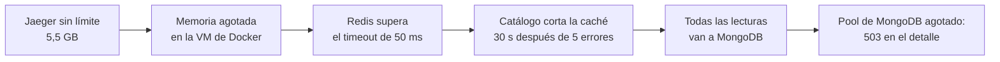

# Postmortems

Análisis de fallas del sistema, provocadas o no, en formato sin culpables: qué pasó, cómo se vio, qué se hizo y qué se cambia. Las horas son de Argentina (UTC−3), salvo que se indique lo contrario.

| # | Fecha | Incidente | Tipo | Impacto | Estado |
|---|---|---|---|---|---|
| 1 | 2026-11-10 | [Jaeger agota la memoria durante la prueba de carga](#1-jaeger-agota-la-memoria-durante-la-prueba-de-carga) | No planificado | 0,02 % de `503` en el detalle; una medición inválida | Cerrado |
| 2 | 2026-11-10 | [Caída de OpenSearch](#2-caída-de-opensearch) | Ensayo controlado | Búsqueda sin servicio ~1 min; nada más afectado | Cerrado |
| 3 | 2026-10-23 | Caída del servidor de correo | Ensayo controlado | Documentado en [ADR-010](adr/ADR-010-resiliencia.md#revisiones) | Cerrado |
| 4 | Jornada grupal | [Caída de una instancia de Catálogo](#4-caída-de-una-instancia-de-catálogo) | Ensayo controlado | — | **Pendiente** (Trucco) |
| 5 | Jornada grupal | [Caída del proveedor (Estudiario)](#5-caída-del-proveedor-estudiario) | Ensayo controlado | — | **Pendiente** (Scaglia) |

---

## 1. Jaeger agota la memoria durante la prueba de carga

**Resumen.** Durante la prueba de carga del detalle de ofertas ([ADR-007](adr/ADR-007-cache.md), [ADR-013](adr/ADR-013-capacidad-y-costos.md)), Jaeger, que guarda las trazas en memoria, creció sin límite hasta 5,5 GB de los 7,4 GB disponibles para Docker. El resto de los contenedores quedó sin memoria: Redis empezó a superar su timeout, Catálogo cortó la caché y mandó todas las lecturas a MongoDB, que agotó su pool de conexiones. El sistema siguió atendiendo, pero una de las mediciones quedó inválida.

**Impacto.**
- 153 de 663 520 solicitudes del detalle (0,02 %) respondieron `503 servicio-no-disponible` en la corrida con caché.
- La corrida sin caché quedó inválida: p99 de 66 s y Docker Desktop respondiendo `500` a los comandos.
- No hubo pérdida de datos: era un entorno de prueba, y las compras, el carrito y la búsqueda no estaban en carga en ese momento.

**Línea de tiempo** (2026-11-10; horas al minuto, reconstruidas de los logs de k6 y de Docker):

| Hora | Hecho |
|---|---|
| 11:41 | Arranca la prueba (k6 crea 1000 ofertas de prueba y empieza a medir). Cada solicitud genera una traza que se exporta a Jaeger |
| 11:45 – 11:49 | Corrida del detalle **con** caché: 853 000 solicitudes en ~3,5 min. Aparecen 153 respuestas `503` |
| 11:50 | Al revisar los logs de Catálogo: 133 errores "timed out while checking out a connection from connection pool" de MongoDB y 4 avisos "Redis falla seguido: se deja de usar la caché por un tiempo" |
| 11:50 – 11:58 | Dos intentos de la corrida **sin** caché. El primero pierde la salida de k6; el segundo da p99 de 66 s. Docker devuelve `500 Internal Server Error` a `docker stats` |
| 11:58 | `docker stats` muestra **Jaeger con 5,546 GiB** de 7,434 GiB. MongoDB, en cambio, con apenas 38 MiB (sin la presión de memoria usó 200 a 300 MiB) |
| 12:01 | Se agrega `MEMORY_MAX_TRACES: "20000"` a Jaeger en `docker-compose.yml` y se lo recrea: baja a 15 MiB |
| 12:02 – 12:15 | Se repiten las dos corridas en las mismas condiciones: 0 errores, Jaeger estable en ~225 MiB |

**Detección.** Por los resultados de la prueba (errores en k6 y un p99 absurdo), no por una alerta. El tablero de Grafana no tiene un panel de memoria por contenedor.

**Causa.** Jaeger *all-in-one* usa almacenamiento en memoria sin límite por defecto. Con cientos de miles de solicitudes trazadas, creció hasta quitarle memoria al resto. La cadena:

**Qué funcionó.**
- El corte de la caché hizo lo que debía: ante fallas de Redis, Catálogo siguió respondiendo desde MongoDB en lugar de esperar el timeout en cada solicitud.
- Los errores fueron `503` con `problem+json`, no cuelgues: el cliente sabe que puede reintentar.
- Las dos instancias de Catálogo siguieron sanas (`/health` no depende de Redis).

**Qué no funcionó.**
- Nada avisó. No hay alerta de memoria por contenedor.
- El corte de la caché traslada **todo** el pico a MongoDB de golpe. Sin la falta de memoria, MongoDB sola atendió 4200 consultas por segundo sin errores; con ella, no.

**Acciones.**

| Acción | Estado |
|---|---|
| Limitar Jaeger a 20 000 trazas en memoria (`MEMORY_MAX_TRACES`) | Hecho |
| Registrar en [ADR-007](adr/ADR-007-cache.md) que el corte de la caché traslada el pico a MongoDB | Hecho |
| Agregar a las limitaciones de [ARCHITECTURE.md](ARCHITECTURE.md) las trazas en memoria y el efecto del corte de la caché | Hecho |
| Muestrear trazas bajo carga (por ejemplo, 10 %) en lugar de trazar todo | Pendiente |
| Panel y alerta de memoria por contenedor (cAdvisor o node-exporter en Prometheus) | Pendiente |
| Al reabrir la caché después del corte, dejar pasar una parte de las lecturas en lugar de todas | Pendiente (mejora, no urgente) |

---

## 2. Caída de OpenSearch

**Resumen.** Ensayo controlado: se detuvo OpenSearch con el sistema funcionando, para verificar que solo la búsqueda se ve afectada y que no se pierden los cambios de ofertas hechos durante la caída ([ADR-006](adr/ADR-006-busqueda.md)).

**Impacto.**
- `GET /api/busqueda` respondió `503 busqueda-no-disponible`, con `Retry-After: 5`, en ~2 s, durante ~1 minuto.
- El detalle de ofertas, la disponibilidad, `/health` y el alta de ofertas siguieron funcionando.
- Ningún cambio se perdió.

**Línea de tiempo** (2026-11-10; las dos primeras horas son aproximadas, la de la reconstrucción sale del nombre del índice):

| Hora | Hecho |
|---|---|
| ≈ 11:32 | `docker compose stop opensearch` |
| ≈ 11:32 | La búsqueda responde `503 busqueda-no-disponible` en 2,1 s. El detalle de una oferta responde `200`; `/health` de las dos instancias, `ok` |
| ≈ 11:32 | Se crea la oferta "Hotel frente al lago" (Villa La Angostura) con OpenSearch caído: `201`. Su `OfertaActualizada` llega a `catalogo.indexacion`, falla y pasa a las colas de reintento (5, 15 y 30 s) |
| ≈ 11:33 | `docker compose start opensearch` |
| +48 s | La oferta aparece en la búsqueda, por el reintento de la cola. DLQ `catalogo.indexacion.dlq`: 0 mensajes |
| 11:35:02 | Se ejecuta la reconstrucción del índice (`POST /internal/busqueda/reconstruccion`) para probarla después de la caída: índice `ofertas-20261110-143502` con los 2 documentos, alias movido de forma atómica e índice anterior borrado, en 0,6 s |

**Detección.** Por la respuesta `503` de la búsqueda y por el log `la búsqueda no está disponible` en Catálogo. La métrica `http_requests_total{route="/api/busqueda", status_code="503"}` lo muestra en Prometheus. Falta un panel y una alerta específicos.

**Causa.** Provocada (ensayo).

**Qué funcionó.**
- El aislamiento: la búsqueda falla rápido (timeout de 2 s) y nada más depende de OpenSearch. `/health` no lo incluye, así que el gateway no saca a Catálogo del balanceo por una caída de la búsqueda.
- La cola con reintentos guardó el cambio hecho durante la caída y lo indexó sola al volver.
- La reconstrucción es una red de seguridad que no corta la búsqueda (cambio atómico del alias).

**Riesgo detectado.** Los reintentos cubren unos 50 s (5 + 15 + 30). Si OpenSearch está caído más tiempo, los cambios de ese lapso van a la DLQ y **la búsqueda queda desactualizada** hasta que alguien reprocese la DLQ o reconstruya el índice: no hay nada automático.

**Acciones.**

| Acción | Estado |
|---|---|
| Documentar el comportamiento y el riesgo en [ADR-006](adr/ADR-006-busqueda.md#revisiones) y en las limitaciones | Hecho |
| Alerta cuando `catalogo.indexacion.dlq` tenga mensajes (señal de que la búsqueda puede estar desactualizada) | Pendiente |
| Panel con el p95 de `busqueda_retraso_indexacion_segundos` y alerta si supera 5 s durante 5 min (definido en ADR-006) | Pendiente (tablero de Trucco) |

---

## 4. Caída de una instancia de Catálogo

*A completar en la jornada de fallas (plan de desarrollo, §6). Dueño: Trucco.*

- **Comando:** `docker compose stop catalogo-2`
- **Esperado:** el gateway la saca del pool en unos 15 s, el tráfico va a `catalogo-1`, se dispara la alerta, y vuelve sola al levantarla.
- **Datos a registrar:** hora de la caída, hora en que el gateway la sacó del pool (log o métrica `gateway_instancia_sana`), hora de la alerta, errores vistos por el cliente durante la transición, hora de vuelta. Captura del panel de solicitudes por instancia.

## 5. Caída del proveedor (Estudiario)

*A completar en la jornada de fallas. Dueño: Scaglia.*

- **Cómo:** `ESTUDIARIO_URL` a un puerto apagado, o `Prefer: code=503` contra su mock.
- **Esperado:** el circuito se abre; el detalle muestra "Guías no disponibles por el momento"; compartir una guía queda `POR_ENVIAR` y se envía al volver.
- **Datos a registrar:** hora de la caída, hora de apertura del circuito, qué vio el usuario (captura), hora de vuelta y de envío de las guías pendientes.
