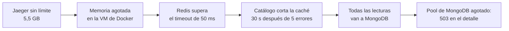

# Postmortems

Análisis de fallas del sistema, provocadas o no, en formato sin culpables: qué pasó, cómo se vio, qué se hizo y qué se cambia. Las horas son de Argentina (UTC−3), salvo que se indique lo contrario.

| # | Fecha | Incidente | Tipo | Impacto | Estado |
|---|---|---|---|---|---|
| 1 | 2026-11-10 | [Jaeger agota la memoria durante la prueba de carga](#1-jaeger-agota-la-memoria-durante-la-prueba-de-carga) | No planificado | 0,02 % de `503` en el detalle; una medición inválida | Cerrado |
| 2 | 2026-11-10 | [Caída de OpenSearch](#2-caída-de-opensearch) | Ensayo controlado | Búsqueda sin servicio ~1 min; nada más afectado | Cerrado |
| 3 | 2026-10-23 | Caída del servidor de correo | Ensayo controlado | Documentado en [ADR-010](adr/ADR-010-resiliencia.md#revisiones) | Cerrado |
| 4 | 2026-11-10 | [Caída de una instancia de Catálogo](#4-caída-de-una-instancia-de-catálogo) | Ensayo controlado | 3 de 224 lecturas con `502` durante ~17 s; corregido (0 en la repetición) | Cerrado |
| 5 | 2026-11-10 | [Caída del proveedor (Estudiario)](#5-caída-del-proveedor-estudiario) | Ensayo controlado | Guías sin servicio ~1 min; compartir una guía devolvía `502` aunque se guardaba; corregido | Cerrado |

---

## 1. Jaeger agota la memoria durante la prueba de carga

**Resumen.** Durante la prueba de carga del detalle de ofertas ([ADR-007](adr/ADR-007-cache.md), [ADR-013](adr/ADR-013-capacidad-y-costos.md)), Jaeger, que guarda las trazas en memoria, creció sin límite hasta 5,5 GB de los 7,4 GB disponibles para Docker. El resto de los contenedores quedó sin memoria: Redis empezó a superar su timeout, Catálogo cortó la caché y mandó todas las lecturas a MongoDB, que agotó su pool de conexiones. El sistema siguió atendiendo, pero una de las mediciones quedó inválida.

**Impacto.**
- 153 de 663 520 solicitudes del detalle (0,02 %) respondieron `503 servicio-no-disponible` en la corrida con caché.
- La corrida sin caché quedó inválida: p99 de 66 s y Docker Desktop respondiendo `500` a los comandos.
- No hubo pérdida de datos: era un entorno de prueba, y las compras, el carrito y la búsqueda no estaban en carga en ese momento.

**Línea de tiempo** (2026-11-10; horas al minuto, reconstruidas de los logs de k6 y de Docker):

| Hora | Hecho |
|---|---|
| 11:41 | Arranca la prueba (k6 crea 1000 ofertas de prueba y empieza a medir). Cada solicitud genera una traza que se exporta a Jaeger |
| 11:45 – 11:49 | Corrida del detalle **con** caché: 853 000 solicitudes en ~3,5 min. Aparecen 153 respuestas `503` |
| 11:50 | Al revisar los logs de Catálogo: 133 errores "timed out while checking out a connection from connection pool" de MongoDB y 4 avisos "Redis falla seguido: se deja de usar la caché por un tiempo" |
| 11:50 – 11:58 | Dos intentos de la corrida **sin** caché. El primero pierde la salida de k6; el segundo da p99 de 66 s. Docker devuelve `500 Internal Server Error` a `docker stats` |
| 11:58 | `docker stats` muestra **Jaeger con 5,546 GiB** de 7,434 GiB. MongoDB, en cambio, con apenas 38 MiB (sin la presión de memoria usó 200 a 300 MiB) |
| 12:01 | Se agrega `MEMORY_MAX_TRACES: "20000"` a Jaeger en `docker-compose.yml` y se lo recrea: baja a 15 MiB |
| 12:02 – 12:15 | Se repiten las dos corridas en las mismas condiciones: 0 errores, Jaeger estable en ~225 MiB |

**Detección.** Por los resultados de la prueba (errores en k6 y un p99 absurdo), no por una alerta. El tablero de Grafana no tiene un panel de memoria por contenedor.

**Causa.** Jaeger *all-in-one* usa almacenamiento en memoria sin límite por defecto. Con cientos de miles de solicitudes trazadas, creció hasta quitarle memoria al resto. La cadena:

**Qué funcionó.**
- El corte de la caché hizo lo que debía: ante fallas de Redis, Catálogo siguió respondiendo desde MongoDB en lugar de esperar el timeout en cada solicitud.
- Los errores fueron `503` con `problem+json`, no cuelgues: el cliente sabe que puede reintentar.
- Las dos instancias de Catálogo siguieron sanas (`/health` no depende de Redis).

**Qué no funcionó.**
- Nada avisó. No hay alerta de memoria por contenedor.
- El corte de la caché traslada **todo** el pico a MongoDB de golpe. Sin la falta de memoria, MongoDB sola atendió 4200 consultas por segundo sin errores; con ella, no.

**Acciones.**

| Acción | Estado |
|---|---|
| Limitar Jaeger a 20 000 trazas en memoria (`MEMORY_MAX_TRACES`) | Hecho |
| Registrar en [ADR-007](adr/ADR-007-cache.md) que el corte de la caché traslada el pico a MongoDB | Hecho |
| Agregar a las limitaciones de [ARCHITECTURE.md](ARCHITECTURE.md) las trazas en memoria y el efecto del corte de la caché | Hecho |
| Muestrear trazas bajo carga (por ejemplo, 10 %) en lugar de trazar todo | Pendiente |
| Panel y alerta de memoria por contenedor (cAdvisor o node-exporter en Prometheus) | Pendiente |
| Al reabrir la caché después del corte, dejar pasar una parte de las lecturas en lugar de todas | Pendiente (mejora, no urgente) |

---

## 2. Caída de OpenSearch

**Resumen.** Ensayo controlado: se detuvo OpenSearch con el sistema funcionando, para verificar que solo la búsqueda se ve afectada y que no se pierden los cambios de ofertas hechos durante la caída ([ADR-006](adr/ADR-006-busqueda.md)).

**Impacto.**
- `GET /api/busqueda` respondió `503 busqueda-no-disponible`, con `Retry-After: 5`, en ~2 s, durante ~1 minuto.
- El detalle de ofertas, la disponibilidad, `/health` y el alta de ofertas siguieron funcionando.
- Ningún cambio se perdió.

**Línea de tiempo** (2026-11-10; las dos primeras horas son aproximadas, la de la reconstrucción sale del nombre del índice):

| Hora | Hecho |
|---|---|
| ≈ 11:32 | `docker compose stop opensearch` |
| ≈ 11:32 | La búsqueda responde `503 busqueda-no-disponible` en 2,1 s. El detalle de una oferta responde `200`; `/health` de las dos instancias, `ok` |
| ≈ 11:32 | Se crea la oferta "Hotel frente al lago" (Villa La Angostura) con OpenSearch caído: `201`. Su `OfertaActualizada` llega a `catalogo.indexacion`, falla y pasa a las colas de reintento (5, 15 y 30 s) |
| ≈ 11:33 | `docker compose start opensearch` |
| +48 s | La oferta aparece en la búsqueda, por el reintento de la cola. DLQ `catalogo.indexacion.dlq`: 0 mensajes |
| 11:35:02 | Se ejecuta la reconstrucción del índice (`POST /internal/busqueda/reconstruccion`) para probarla después de la caída: índice `ofertas-20261110-143502` con los 2 documentos, alias movido de forma atómica e índice anterior borrado, en 0,6 s |

**Detección.** Por la respuesta `503` de la búsqueda y por el log `la búsqueda no está disponible` en Catálogo. La métrica `http_requests_total{route="/api/busqueda", status_code="503"}` lo muestra en Prometheus. Falta un panel y una alerta específicos.

**Causa.** Provocada (ensayo).

**Qué funcionó.**
- El aislamiento: la búsqueda falla rápido (timeout de 2 s) y nada más depende de OpenSearch. `/health` no lo incluye, así que el gateway no saca a Catálogo del balanceo por una caída de la búsqueda.
- La cola con reintentos guardó el cambio hecho durante la caída y lo indexó sola al volver.
- La reconstrucción es una red de seguridad que no corta la búsqueda (cambio atómico del alias).

**Riesgo detectado.** Los reintentos cubren unos 50 s (5 + 15 + 30). Si OpenSearch está caído más tiempo, los cambios de ese lapso van a la DLQ y **la búsqueda queda desactualizada** hasta que alguien reprocese la DLQ o reconstruya el índice: no hay nada automático.

**Acciones.**

| Acción | Estado |
|---|---|
| Documentar el comportamiento y el riesgo en [ADR-006](adr/ADR-006-busqueda.md#revisiones) y en las limitaciones | Hecho |
| Alerta cuando `catalogo.indexacion.dlq` tenga mensajes (señal de que la búsqueda puede estar desactualizada) | Pendiente |
| Panel con el p95 de `busqueda_retraso_indexacion_segundos` y alerta si supera 5 s durante 5 min (definido en ADR-006) | Pendiente (tablero de Trucco) |

---

## 4. Caída de una instancia de Catálogo

**Resumen.** Ensayo controlado: se detuvo `catalogo-2` con tráfico constante a través del gateway (una lectura de `GET /api/packs` cada ~0,5 s), para medir cuánto tarda el gateway en sacarla del balanceo, si el cliente ve errores, si se dispara la alerta y si vuelve sola ([ADR-012](adr/ADR-012-balanceo-de-carga.md)). Complementa el [ensayo de Trucco](ensayos/2026-11-10-balanceo-gateway.md), que verificó el comportamiento pero no registró tiempos ni errores durante la transición.

**Impacto.**
- Primera corrida: **3 de 224 lecturas (1,3 %) respondieron `502`** en los ~17 s entre la caída y la salida del pool. Las demás, `200` desde `catalogo-1`.
- Nada más afectado: escrituras, Reservas y Usuarios siguieron normales. No hubo pérdida de datos (el estado vive en MySQL y MongoDB, compartidas por las dos instancias).
- Después de la corrección, la repetición dio **0 errores**.

**Línea de tiempo** (2026-11-10; horas de los logs del ensayo y del historial de Prometheus):

| Hora | Hecho |
|---|---|
| 17:02:33 | `docker compose stop catalogo-2` |
| 17:02:40 – 17:02:49 | Tres lecturas reciben `502 servicio-no-disponible`: el round robin le sigue mandando una de cada dos a la instancia caída |
| ≈ 17:02:50 | `gateway_instancia_sana{instancia="catalogo-2"}` pasa a `0` (3 chequeos de `/health` fallidos, cada 5 s). Desde acá, todo va a `catalogo-1` sin errores. La alerta `InstanciaCatalogoFueraDelPool` queda `pending` |
| ≈ 17:03:50 | La alerta pasa a `firing` (regla con `for: 1m`) |
| 17:06:16 | `docker compose start catalogo-2` |
| ≈ 17:06:30 | Vuelve al pool (2 chequeos sanos) y recibe tráfico otra vez |
| 17:07:53 | La alerta se resuelve |
| 17:13 – 17:14 | Repetición con la corrección: caída a las 17:13:45, fuera del pool a las 17:13:56 (11 s), vuelta a las 17:14:25. **34 de 34 lecturas con `200`**; el gateway registró dos "se reintenta en otra" |

**Detección.** Por la métrica `gateway_instancia_sana` en el tablero y la alerta de Prometheus, como estaba previsto. El log del gateway "cambió el estado de una instancia de Catálogo" marca el momento exacto.

**Causa** de los `502`: el gateway solo se enteraba de la caída por los chequeos periódicos (3 fallas × 5 s). Mientras tanto, la instancia seguía en el round robin y la solicitud que le tocaba fallaba en la conexión y llegaba al cliente como `502`.

**Qué funcionó.**
- El pool retiró la instancia y la reincorporó sola, con las cifras de ADR-012 (3 fallas para salir, 2 éxitos para volver).
- La alerta se disparó y se resolvió sola.
- Una instancia alcanzó para todo el tráfico del ensayo.

**Qué se corrigió.** El gateway ahora repite **una vez en otra instancia sana** las lecturas (`GET`, `HEAD`) que no llegan a la elegida (conexión rechazada o timeout), y cuenta esa falla para sacarla del pool sin esperar a los chequeos (detección pasiva). Las escrituras no se repiten: un error de transporte no dice si la instancia llegó a aplicar el cambio. Tests: `TestPoolReintentaUnaLecturaEnOtraInstanciaSiLaElegidaEstaCaida` y `TestPoolNoReintentaUnaEscritura` en `gateway/internal/gateway`.

**Acciones.**

| Acción | Estado |
|---|---|
| Reintento de lecturas en otra instancia y detección pasiva en el gateway | Hecho |
| Registrar el reintento en [ADR-012](adr/ADR-012-balanceo-de-carga.md#revisiones) | Hecho |
| Una escritura que cae justo en la instancia que se cae sigue recibiendo `502`; el cliente la reintenta con su `Idempotency-Key` donde aplica | Aceptado (riesgo conocido) |

---

## 5. Caída del proveedor (Estudiario)

**Resumen.** Ensayo controlado: se detuvo Estudiario con el sistema funcionando, para verificar que la falla del proveedor no afecta la compra ni el detalle de las ofertas, que el circuit breaker corta las llamadas, que las guías compartidas durante la caída se envían solas al volver, y qué ve el usuario ([ADR-009](adr/ADR-009-consumo-del-proveedor.md), [ADR-010](adr/ADR-010-resiliencia.md)). Se hizo contra el **mock** de su contrato (`estudiario-mock`, apuntando Catálogo y Reservas a él) para no subir PDFs de prueba a la moderación del Estudiario real ni gastar su cupo.

**Impacto.**
- Detalle de la oferta, disponibilidad, carrito y compra: **sin impacto**.
- **Guías del destino** (`GET /api/ofertas/{id}/guias`): durante los primeros minutos, ninguno (salen de la caché de Redis, que las guarda 5 minutos por destino). Al vencer la caché, `200 {"disponible": false}`; el detalle muestra "Guías no disponibles por el momento. El resto de la oferta funciona con normalidad". Las primeras 5 consultas por instancia tardaron **6,5 s** (3 intentos con timeout de 2 s); con el circuito abierto, **0,2 s**.
- **Compartir una guía** (`POST /api/guias`): **respondía `502` a los 15 s**, aunque la guía **sí** quedaba guardada `POR_ENVIAR`. El usuario veía un error por algo que había funcionado, y si reintentaba la subía dos veces. Corregido durante el ensayo: ahora responde `202 POR_ENVIAR` en 8 s.
- Ninguna guía se perdió: las dos compartidas durante la caída se enviaron solas al volver.

**Línea de tiempo** (2026-11-10):

| Hora | Hecho |
|---|---|
| 17:15:34 | `docker compose stop estudiario-mock` |
| 17:15:35 – 17:15:59 | Las guías del detalle siguen respondiendo `disponible: true` desde la caché |
| 17:16:11 | Se comparte una guía de Bariloche: el gateway corta a los **15 s** con `502`. En Reservas, la guía quedó `POR_ENVIAR` |
| 17:16 – 17:21 | Se acota el intento inmediato a 8 s en Reservas (ver abajo), con test, y se reconstruye el servicio |
| 17:21:41 | Se comparte otra guía: **`202 POR_ENVIAR` en 8 s** |
| 17:22:20 | Vencida la caché, el detalle responde `disponible: false` en 6,5 s por consulta. Log de Catálogo: "guías no disponibles: Estudiario no respondió" |
| ≈ 17:23:32 | A la quinta falla seguida de cada instancia **se abre el circuito**: las consultas responden en ~200 ms sin llamar al proveedor (error "circuito abierto" en el log) |
| 17:23:43 | `docker compose start estudiario-mock` |
| 17:23:56 | Las guías vuelven a mostrarse (prueba semiabierta del circuito exitosa) |
| 17:24:29 | El proceso de Reservas (cada 30 s) envía las 2 guías pendientes con su misma `Idempotency-Key`: pasan a `PENDIENTE`. Log: "guías enviadas a Estudiario" |

**Detección.** Por los logs de advertencia de Catálogo ("guías no disponibles") y de Reservas, y por la respuesta `disponible: false`. No hay alerta: es una capacidad no imprescindible y la caída de un servicio ajeno no requiere que actuemos.

**Causa** del `502` al compartir: el intento de envío "en el momento" usaba la configuración del registro, pensada para el proceso de fondo: 20 s por intento y reintentos a 1, 2 y 4 s. Con el proveedor caído, eso supera el timeout de 15 s del gateway, que corta y responde `502` mientras Reservas sigue esperando.

**Qué funcionó.**
- El aislamiento: ninguna pantalla del flujo de compra depende de Estudiario, y el detalle nunca falla por el proveedor.
- La caché de guías ocultó por completo una caída corta.
- El circuit breaker cortó las llamadas a la quinta falla y se recuperó solo con la prueba semiabierta.
- La cola `POR_ENVIAR` con `Idempotency-Key` fija: las guías se enviaron solas, una sola vez.

**Qué se corrigió.** `Compartir` (Reservas, `internal/application/guias.go`) espera a Estudiario como máximo **8 s** (`EsperaEnvioInmediato`, por debajo de los 15 s del gateway). Si no termina, responde `202 POR_ENVIAR` y lo completa el proceso de fondo con la misma clave, así que un registro que llegó a Estudiario justo al vencer no se duplica. Test: `TestCompartirNoEsperaMasDelLimiteSiEstudiarioNoResponde`.

**Acciones.**

| Acción | Estado |
|---|---|
| Acotar el envío inmediato de una guía por debajo del timeout del gateway | Hecho |
| Registrar el comportamiento ante la caída en [ADR-009](adr/ADR-009-consumo-del-proveedor.md#revisiones) | Hecho |
| Las primeras consultas de guías tardan 6,5 s hasta que se abre el circuito. El frontend las carga aparte ("Buscando guías…"), así que no bloquea el detalle; si molesta, bajar a 1 reintento la lectura de guías | Aceptado |
