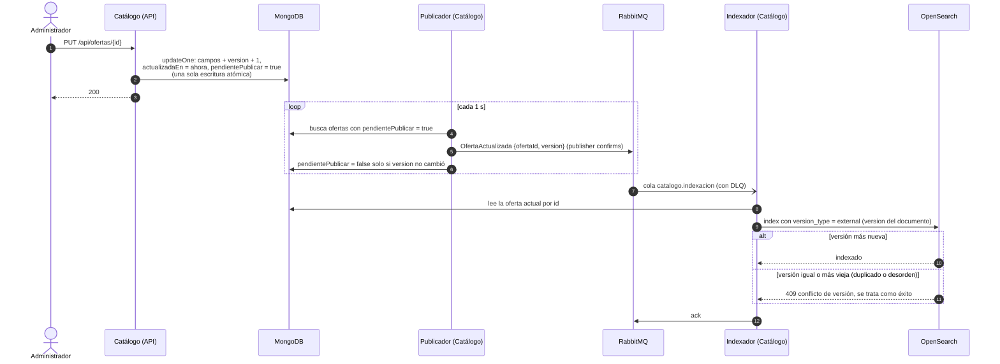

# ADR-006: Búsqueda

- **Estado:** Aceptada
- **Fecha:** 2026-10-23
- **Decisión de la cátedra:** D6

## Contexto

HU-01 pide buscar ofertas por destino, tipo, subtipo de transporte, rango de fechas y rango de precio, ordenar por precio o por fecha, y paginar. Una oferta creada o modificada por el administrador debe aparecer en la búsqueda dentro de un retraso máximo definido.

Las ofertas viven en MongoDB, dentro de Catálogo ([ADR-003](ADR-003-persistencia.md)). Cada tipo (vuelo, tren, colectivo, estadía, excursión) tiene atributos propios. La disponibilidad (`DISPONIBLE`, `RETENIDA`, `AGOTADA`) no está en MongoDB: se calcula en MySQL a partir del inventario y las retenciones ([ADR-014](ADR-014-cupos-en-catalogo-con-retencion.md)).

## Decisión

### Qué se indexa

La entidad indexada es la **Oferta**, en un índice de **OpenSearch** al que se accede siempre por el alias `ofertas`. Es una proyección derivada de MongoDB y se puede reconstruir en cualquier momento.

| Campo | Tipo en OpenSearch | Uso |
|---|---|---|
| `id` | `keyword` | Identificador; desempate del orden |
| `tipo` | `keyword` (`TRANSPORTE`, `ESTADIA`, `EXCURSION`) | Filtro |
| `subtipoTransporte` | `keyword` (`AVION`, `TREN`, `COLECTIVO`), solo transportes | Filtro |
| `destino` | `keyword` normalizado (minúsculas, sin acentos) | Filtro exacto |
| `fechaInicio`, `fechaFin` | `date` | Filtro por rango y orden por fecha. En transportes son salida y llegada |
| `precio` | `scaled_float` (factor 100) | Filtro por rango y orden. Factor 100 = centavos, igual que `DECIMAL(12,2)`; no se usa `float` |
| `titulo`, `descripcion`, `destino` | `text` con analizador `spanish` | Búsqueda por texto libre |
| `publicada` | `boolean` | Solo se devuelven ofertas publicadas |
| `version`, `actualizadaEn` | `long`, `date` | Control de versiones y medición del retraso |

Las ofertas despublicadas no se borran del índice: se indexan con `publicada = false` y se filtran. Así todos los cambios, incluida la baja, siguen la misma regla de versiones.

### La disponibilidad NO se indexa

1. **Cambia por el paso del tiempo, sin escrituras.** Una oferta `RETENIDA` vuelve a estar `DISPONIBLE` en el instante en que vence una retención (`expira_en > NOW()`, ADR-014), sin que nada se escriba en ese momento. El índice mostraría un estado viejo justo en el caso que más interesa.
2. **Cambia muy seguido.** Cada retener, liberar, confirmar o vencer modifica la disponibilidad. Indexarla multiplicaría las escrituras en OpenSearch por la cantidad de operaciones de carrito, cuando las descripciones cambian pocas veces por día.
3. **No hace falta para HU-01.** Ningún filtro de la historia es "solo disponibles". La disponibilidad se muestra en el **detalle** de la oferta (HU-01, RN-13), que la consulta a la fuente de verdad (`GET /api/ofertas/{id}/disponibilidad`) y la mantiene al día por SSE ([ADR-015](ADR-015-disponibilidad-en-tiempo-real.md)).

### Consultas

`GET /api/busqueda` (pública, vía gateway):

| Parámetro | Consulta en OpenSearch |
|---|---|
| `destino` | `term` sobre `destino` normalizado |
| `tipo`, `subtipoTransporte` | `term` |
| `desde`, `hasta` | `range` sobre `fechaInicio` (la oferta empieza dentro del rango) |
| `precioMin`, `precioMax` | `range` sobre `precio` |
| `q` (opcional) | `multi_match` sobre `titulo`, `descripcion` y `destino` |
| `orden` | `precio` o `fecha`, `asc` o `desc`; desempate siempre por `id` |
| `pagina`, `tamanio` | Paginación (ver abajo) |

Todos los filtros van en contexto `filter` (no puntúan y OpenSearch los cachea). Solo el texto libre aporta relevancia; si hay `q` y no se pide orden, se ordena por relevancia.

### Paginación: `from`/`size` con límite

- `tamanio` por defecto 20, máximo 50.
- Se permiten como máximo **50 páginas** (`from + size ≤ 1000`). Más allá, la API responde `400` y sugiere refinar los filtros.
- La respuesta incluye `total` (con `track_total_hits` hasta 1000) para mostrar la cantidad de páginas.

Se elige `from`/`size` porque la interfaz es una lista con páginas numeradas ("ir a la página 3"), y un usuario que busca viajes refina los filtros en lugar de recorrer cientos de páginas. El costo de `from`/`size` crece con la profundidad, pero el límite de 1000 resultados lo acota. El desempate por `id` hace que el orden sea estable entre páginas.

### Sincronización por eventos

**Publicación confiable con el outbox dentro del documento.** La oferta está en MongoDB y el outbox de Catálogo en MySQL ([ADR-014](ADR-014-cupos-en-catalogo-con-retencion.md)). No hay transacción común entre ambos, así que guardar el evento en la tabla `outbox` de MySQL podría perderlo si el servicio se cae entre las dos escrituras. En su lugar, **cada documento de oferta hace de su propio outbox**:

- Toda modificación de una oferta, en la **misma escritura de un solo documento** (atómica en MongoDB sin necesidad de transacciones), incrementa `version`, actualiza `actualizadaEn` y marca `pendientePublicar = true`.
- Un publicador busca ofertas con `pendientePublicar = true` (campo con índice parcial), publica `OfertaActualizada` con publisher confirms y recién después desmarca **con condición sobre la versión** (`updateOne({_id, version: v}, {$set: {pendientePublicar: false}})`). Si la oferta cambió entre medio, la condición falla, la marca sigue puesta y se publica de nuevo.
- Si el servicio se cae en cualquier punto, la marca persiste y el evento se publica al volver: puede publicarse dos veces, nunca cero.

**Indexación idempotente.** El evento solo lleva `ofertaId` y `version`. El indexador lee el documento **actual** de MongoDB y lo indexa con `version_type = external`, usando la `version` del documento. OpenSearch rechaza cualquier versión menor o igual a la indexada, así que un evento duplicado o que llega desordenado no puede volver atrás el índice. Ese `409` se confirma como éxito.

**Mensajes fallidos.** Cola durable `catalogo.indexacion` con hasta 3 reintentos con espera creciente y luego `catalogo.indexacion.dlq` (como en [ADR-005](ADR-005-comunicacion-entre-servicios.md)). Un mensaje en la DLQ significa que esa oferta puede estar desactualizada en la búsqueda. Se reprocesa desde la DLQ, o se corrige con una reconstrucción.

### Reconstrucción completa

Para cambios de mapping, corrupción del índice o mensajes perdidos (operación manual del administrador, `POST /internal/busqueda/reconstruccion`):

1. Se registra el instante `T0` y se crea un índice nuevo `ofertas-<fecha>` con el mapping vigente.
2. Se recorren todas las ofertas de MongoDB y se cargan con `_bulk` (lotes de 500) y `version_type = external`.
3. Se mueve el alias `ofertas` al índice nuevo en una operación atómica (`_aliases`). Las búsquedas nunca ven un índice a medio cargar.
4. **Recuperación de lo que cambió durante la carga:** se reindexan las ofertas con `actualizadaEn ≥ T0`. Mientras tanto, el indexador siguió escribiendo en el índice viejo. Las versiones externas impiden que un documento más viejo pise uno más nuevo.
5. El índice anterior se borra después de verificar la cantidad de documentos.

### Retraso máximo tolerable

**Objetivo:** el 95 % de los cambios aparece en la búsqueda en **5 segundos o menos** (p95 ≤ 5 s), y ninguno tarda más de 30 s mientras todos los componentes funcionan. Es un **objetivo, todavía no medido**.

Presupuesto estimado: publicador hasta 1 s + cola e indexación menos de 0,5 s + `refresh_interval` de OpenSearch 1 s ≈ 2,5 s, con margen para picos.

**Cómo se mide:**

- **Métrica continua:** al indexar, el indexador registra `busqueda_retraso_indexacion_segundos = ahora + refresh_interval − actualizadaEn` en un histograma. El tablero de D11 muestra el p95, con una alerta si supera 5 s durante 5 minutos.
- **Prueba de punta a punta:** un script modifica una oferta por la API y consulta `/api/busqueda` cada 100 ms hasta que aparece el cambio. Se repite 100 veces y se registra el p95.

## Alternativas consideradas

- **Buscar directamente en MongoDB.** Evita la sincronización, pero la búsqueda de texto en español con relevancia y la combinación de filtros con orden son la especialidad de un motor de búsqueda; además se pierde el requisito del enunciado. Descartada.
- **Indexar la disponibilidad.** Permitiría filtrar "solo disponibles", pero el índice estaría desactualizado precisamente cuando vencen las retenciones (cambian por tiempo, sin escrituras) y multiplicaría las escrituras en OpenSearch. Descartada. Si en el futuro se pide ocultar ofertas agotadas, se podría indexar solo `agotada` (cambia pocas veces: cuando `vendidos` alcanza `cupo_total`).
- **Outbox en la tabla MySQL de Catálogo** para `OfertaActualizada`. No hay transacción común entre MongoDB y MySQL: una caída entre las dos escrituras pierde el evento. Descartada.
- **MongoDB como replica set con transacciones o Change Streams.** Ambos resuelven la publicación confiable, pero exigen convertir MongoDB en replica set (más configuración en el entorno local y en la nube). El outbox dentro del documento logra lo mismo con una escritura atómica de un documento. Descartada por ahora.
- **Sincronizar al momento de buscar.** Haría cada búsqueda tan lenta como recorrer MongoDB y no garantiza ningún retraso máximo. Descartada.
- **Paginación con `search_after`.** No se degrada con la profundidad y es la opción para scroll infinito, pero no permite saltar a una página numerada. Con el límite de 1000 resultados, `from`/`size` alcanza. Se reconsidera si la interfaz pasa a scroll infinito.

## Consecuencias

- (+) Búsqueda con texto, filtros, orden y paginación sin cargar MongoDB.
- (+) Ningún cambio de oferta se pierde: el outbox en el documento sobrevive a caídas del servicio y del broker.
- (+) Indexar es idempotente y tolera desorden gracias a las versiones externas.
- (+) El índice se puede reconstruir sin cortar la búsqueda (cambio atómico del alias).
- (−) La búsqueda es eventualmente consistente: hay hasta unos segundos (objetivo p95 ≤ 5 s) entre el cambio y su aparición.
- (−) Los resultados no muestran la disponibilidad; una oferta agotada aparece en la búsqueda y el cliente se entera en el detalle.
- (−) Cada documento de oferta lleva campos técnicos (`version`, `pendientePublicar`) y Catálogo suma un publicador que consulta MongoDB cada segundo.
- (−) No se puede pasar de la página 50 de resultados.
- (−) Si OpenSearch no está disponible, la búsqueda responde `503`; el detalle, el carrito y la compra siguen funcionando ([ADR-010](ADR-010-resiliencia.md)).
