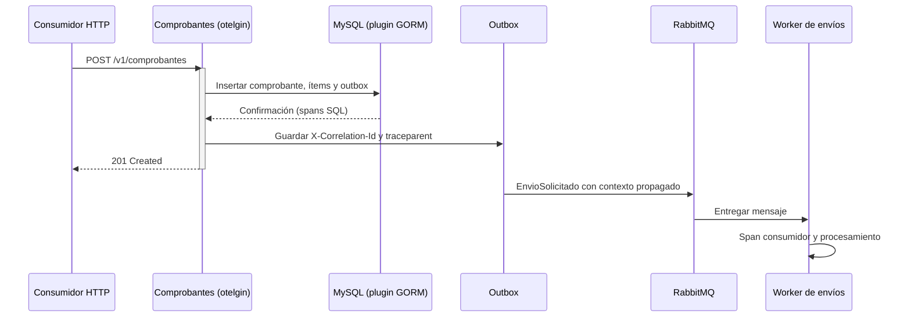

# ADR-011: Observabilidad

- **Estado:** Propuesta (versión inicial para la Entrega 2)
- **Fecha:** 2026-10-23
- **Decisión de la cátedra:** D11

## Contexto

El flujo principal atraviesa HTTP, MySQL, el outbox, RabbitMQ y el envío SMTP. Para poder explicar una demora o falla necesitamos correlacionar logs y seguir una operación entre procesos. Además, la entrega requiere una primera traza distribuida; las métricas y el tablero quedan como propuesta para completar la observabilidad.

## Decisión

### Logs estructurados y correlación

Todos los servicios Go usan `log/slog` con salida JSON. Los campos comunes son:

| Campo | Uso |
|---|---|
| `time`, `level`, `msg` | Momento, severidad y evento |
| `servicio`, `componente` | Servicio y proceso (API, consumidor, worker, publicador) |
| `correlacion_id` | Identificador común del flujo, tomado de `X-Correlation-Id` o generado al entrar por HTTP |
| `trace_id`, `span_id` | Identificadores W3C cuando hay un span activo |
| Campos de operación | `metodo`, `ruta`, `estado`, `duracion_ms`, `evento_id`, `tipo`, `compra_id`, `comprobante_id`, `intento` según corresponda |

El middleware HTTP devuelve `X-Correlation-Id` en la respuesta y lo agrega al contexto. Al persistir un evento, el outbox guarda ese valor y `traceparent` en sus headers JSON; el publicador los copia al mensaje RabbitMQ. El consumidor extrae ambos valores, crea un span de consumidor y los usa en sus logs. No se deben registrar secretos, tokens, claves API ni cuerpos que contengan datos personales innecesarios.

### Trazas distribuidas

Se adopta OpenTelemetry como API/SDK e instrumentación. El contexto se propaga con W3C Trace Context (`traceparent`) y Baggage, tanto en HTTP como en los headers de RabbitMQ. El primer recorrido instrumentado de Comprobantes contiene:

Jaeger es el backend local elegido para recibir OTLP/HTTP (puerto 4318) y explorar trazas desde su UI (puerto 16686). Se elige por su despliegue simple en Docker Compose y su integración directa con OTLP, apropiada para la primera demostración. La elección no impide cambiar el backend manteniendo la instrumentación OpenTelemetry.

El span HTTP lo genera `otelgin` dentro de `MiddlewareGin`; GORM instrumenta consultas SQL; `ProcesarMensaje` crea spans consumidores y marca los errores. El flujo comparte el contexto aunque el publicador no tenga todavía un span propio: al integrarlo, deberá crear su span de productor usando el contexto recuperado del outbox.

### Métricas y tablero (propuesta)

Se propone Prometheus para recolectar métricas y Grafana para el tablero. Las métricas iniciales por servicio son:

| Servicio/componente | Métricas propuestas |
|---|---|
| Todos los HTTP | Solicitudes por método/ruta/estado, latencia en histograma, tasa de 5xx y estado de salud por instancia |
| Comprobantes | Emisiones, idempotencias/conflictos, envíos por estado, duración hasta `ENVIADO`, errores SMTP y tamaño/antigüedad del outbox |
| RabbitMQ | Mensajes listos/en vuelo, reintentos y cantidad de mensajes en cada `.dlq` |
| Catálogo | Duración de retener/confirmar, conflictos de cupo, retenciones activas/vencidas y contención por oferta |
| Reservas | Carritos y compras por estado, compras `PENDIENTE` y duración de recuperación |
| Tiempo Real | Conexiones SSE abiertas, eventos publicados/entregados y reconexiones |

El tablero de la presentación mostrará: tasa y latencia HTTP (incluidos 5xx), salud y tráfico por instancia, antigüedad del outbox y profundidad de colas/DLQ, estado y demora de envíos, y un enlace de una traza representativa en Jaeger.

### Objetivos y alertas iniciales

- **Objetivo de servicio:** al menos el 99 % de los `POST /v1/comprobantes` responde en menos de 500 ms; al menos el 95 % de los correos termina en `ENVIADO` dentro del minuto posterior a la emisión. Se medirá sobre ventanas móviles de 30 días cuando haya datos suficientes; hasta entonces se reportan los resultados de las pruebas.
- **Alertas:** cualquier mensaje presente en una `.dlq`; tasa de respuestas 5xx superior al 5 % durante 5 minutos; cualquier instancia fuera de salud durante más de 1 minuto. También se observa el outbox más antiguo y los envíos que superen el objetivo de un minuto.

## Alternativas consideradas

- **Logs de texto sin correlación.** Son difíciles de filtrar y no permiten seguir un mensaje entre procesos. Descartada.
- **Propagador propietario.** Requiere adaptaciones específicas y dificulta interoperar. Se elige W3C Trace Context.
- **Backend de trazas propietario o un stack de métricas integrado de entrada.** Se pospone para no acoplar la instrumentación ni ampliar el alcance de la primera entrega; OpenTelemetry permite sustituir el backend.

## Consecuencias

- (+) Logs, solicitudes y mensajes se pueden relacionar con identificadores estables.
- (+) Las consultas a MySQL quedan asociadas al span HTTP y los consumidores pueden continuar el contexto.
- (+) Jaeger puede levantarse junto con el entorno local y no requiere una cuenta externa.
- (−) Prometheus, Grafana y las métricas de negocio aún no están desplegados.
- (−) La propagación del publicador debe conservarse al integrar cambios posteriores de RabbitMQ; hoy se persisten y reenvían los headers, pero falta un span específico de productor.
- (−) Los objetivos iniciales se deben validar con pruebas de carga y datos observados antes de tratarlos como SLO comprometidos.

## Implementación

**Implementado:** logs JSON con `slog`, correlación HTTP, `trace_id`/`span_id`, SDK y propagación W3C, spans HTTP y GORM, span de consumidor, exportación OTLP/HTTP a Jaeger.

**Pendiente:** Prometheus, Grafana, instrumentación de métricas, alertas automatizadas y span propio del publicador de outbox.
