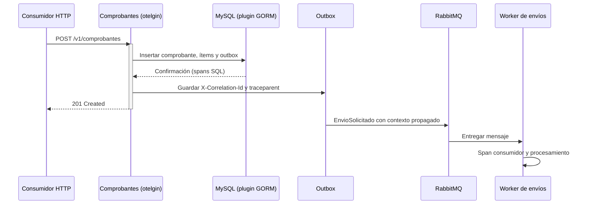

# ADR-011: Observabilidad

- **Estado:** Propuesta (versión inicial para la Entrega 2)
- **Fecha:** 2026-10-23
- **Decisión de la cátedra:** D11

## Contexto

El flujo principal atraviesa HTTP, MySQL, el outbox, RabbitMQ y el envío SMTP. Para poder explicar una demora o falla necesitamos correlacionar logs y seguir una operación entre procesos. La observabilidad local combina logs estructurados, métricas Prometheus, trazas distribuidas y visualización en Grafana; en esta etapa la instrumentación de métricas y persistencia de logs están implementadas en Comprobantes.

## Decisión

### Logs estructurados y correlación

Todos los servicios Go usan `log/slog` con salida JSON. Los campos comunes son:

| Campo | Uso |
|---|---|
| `time`, `level`, `msg` | Momento, severidad y evento |
| `servicio`, `componente` | Servicio y proceso (API, consumidor, worker, publicador) |
| `correlacion_id` | Identificador común del flujo, tomado de `X-Correlation-Id` o generado al entrar por HTTP |
| `trace_id`, `span_id` | Identificadores W3C cuando hay un span activo |
| Campos de operación | `metodo`, `ruta`, `estado`, `duracion_ms`, `evento_id`, `tipo`, `compra_id`, `comprobante_id`, `intento` según corresponda |

El middleware HTTP devuelve `X-Correlation-Id` en la respuesta y lo agrega al contexto. Al persistir un evento, el outbox guarda ese valor y `traceparent` en sus headers JSON; el publicador los copia al mensaje RabbitMQ. El consumidor extrae ambos valores, crea un span de consumidor y los usa en sus logs. No se deben registrar secretos, tokens, claves API ni cuerpos que contengan datos personales innecesarios.

### Trazas distribuidas

Se adopta OpenTelemetry como API/SDK e instrumentación. El contexto se propaga con W3C Trace Context (`traceparent`) y Baggage, tanto en HTTP como en los headers de RabbitMQ. El primer recorrido instrumentado de Comprobantes contiene:

Jaeger es el backend local elegido para recibir OTLP/HTTP (puerto 4318) y explorar trazas desde su UI (puerto 16686). Se elige por su despliegue simple en Docker Compose y su integración directa con OTLP, apropiada para la primera demostración. La elección no impide cambiar el backend manteniendo la instrumentación OpenTelemetry.

El span HTTP lo genera `otelgin` dentro de `MiddlewareGin`; GORM instrumenta consultas SQL; `ProcesarMensaje` crea spans consumidores y marca los errores. El flujo comparte el contexto aunque el publicador no tenga todavía un span propio: al integrarlo, deberá crear su span de productor usando el contexto recuperado del outbox.

### Métricas y tablero

Prometheus recolecta las métricas y Grafana las visualiza junto con los logs consultados desde MySQL. Comprobantes, Reservas y Usuarios exponen `/metrics` con `http_requests_total` y `http_request_duration_seconds`, etiquetadas por método, ruta normalizada y código HTTP; Prometheus hace scraping cada 5 segundos. El Gateway expone sus propias métricas HTTP más `gateway_solicitudes_total{instancia,ruta,estado}` y `gateway_instancia_sana{instancia}`. Grafana aprovisiona ambas fuentes y el dashboard **Agencia de Viajes - Observabilidad**, que muestra tasa de solicitudes, latencia p95, total de solicitudes y errores 5xx, logs de `comprobantes.app_logs`, tráfico del Gateway por upstream, salud de Catálogo y disponibilidad de los targets scrapeados.

Prometheus evalúa reglas cada 15 segundos: una alerta de tasa HTTP 5xx superior al 5 % sostenida por un minuto y otra cuando una instancia de Catálogo permanece fuera del pool durante un minuto. Grafana consulta y presenta las reglas y su estado desde la fuente Prometheus.

Las métricas de negocio iniciales propuestas para los servicios son:

| Servicio/componente | Métricas propuestas |
|---|---|
| Todos los HTTP | Solicitudes por método/ruta/estado, latencia en histograma, tasa de 5xx y estado de salud por instancia |
| Comprobantes | Emisiones, idempotencias/conflictos, envíos por estado, duración hasta `ENVIADO`, errores SMTP y tamaño/antigüedad del outbox |
| RabbitMQ | Mensajes listos/en vuelo, reintentos y cantidad de mensajes en cada `.dlq` |
| Catálogo | Duración de retener/confirmar, conflictos de cupo, retenciones activas/vencidas y contención por oferta |
| Reservas | Carritos y compras por estado, compras `PENDIENTE` y duración de recuperación |
| Tiempo Real | Conexiones SSE abiertas, eventos publicados/entregados y reconexiones |

El dashboard y las alertas son una primera vista. La antigüedad del outbox, la profundidad de colas/DLQ, el estado y la demora de envíos y los enlaces a trazas quedan para integrar cuando estén disponibles las métricas correspondientes. Los paneles y la alerta de Catálogo requieren que Albizu integre sus instancias y que el Gateway reciba sus URLs; mientras no haya targets, Grafana no inventa su estado.

### Objetivos y alertas iniciales

- **Objetivo de servicio:** al menos el 99 % de los `POST /v1/comprobantes` responde en menos de 500 ms; al menos el 95 % de los correos termina en `ENVIADO` dentro del minuto posterior a la emisión. Se medirá sobre ventanas móviles de 30 días cuando haya datos suficientes; hasta entonces se reportan los resultados de las pruebas.
- **Alertas:** cualquier mensaje presente en una `.dlq`; tasa de respuestas 5xx superior al 5 % durante 1 minuto; cualquier instancia fuera de salud durante más de 1 minuto. También se observa el outbox más antiguo y los envíos que superen el objetivo de un minuto.

## Alternativas consideradas

- **Logs de texto sin correlación.** Son difíciles de filtrar y no permiten seguir un mensaje entre procesos. Descartada.
- **Propagador propietario.** Requiere adaptaciones específicas y dificulta interoperar. Se elige W3C Trace Context.
- **Backend de trazas propietario o un stack de métricas integrado de entrada.** Se pospone para no acoplar la instrumentación ni ampliar el alcance de la primera entrega; OpenTelemetry permite sustituir el backend.

## Consecuencias

- (+) Logs, solicitudes y mensajes se pueden relacionar con identificadores estables.
- (+) Las consultas a MySQL quedan asociadas al span HTTP y los consumidores pueden continuar el contexto.
- (+) Jaeger puede levantarse junto con el entorno local y no requiere una cuenta externa.
- (+) Comprobantes mantiene los logs JSON en stdout y los persiste de forma asíncrona en `app_logs`; la cola acotada evita que un fallo de persistencia de logs bloquee las solicitudes de negocio.
- (+) Grafana usa una cuenta MySQL con permiso `SELECT` únicamente sobre `comprobantes.app_logs`.
- (+) El dashboard inicial de Grafana unifica la tasa y latencia de solicitudes HTTP con los logs recientes de Comprobantes.
- (−) Faltan métricas de negocio, colas y outbox; las reglas de alerta están implementadas pero falta demostrar su disparo con tráfico y con la caída real de una réplica.
- (−) La propagación del publicador debe conservarse al integrar cambios posteriores de RabbitMQ; hoy se persisten y reenvían los headers, pero falta un span específico de productor.
- (−) Los objetivos iniciales se deben validar con pruebas de carga y datos observados antes de tratarlos como SLO comprometidos.

## Implementación

**Implementado:** logs JSON con `slog`, correlación HTTP, `trace_id`/`span_id`, persistencia asíncrona de logs de Comprobantes en MySQL, usuario de consulta de solo lectura para Grafana, SDK y propagación W3C, spans HTTP y GORM, span de consumidor, exportación OTLP/HTTP a Jaeger, middleware de métricas HTTP en Comprobantes/Reservas/Usuarios/Gateway, scraping de Prometheus cada 5 segundos, reglas Prometheus consultables en Grafana y dashboard aprovisionado con métricas, logs, salud por instancia y targets.

**Pendiente:** validar en vivo la alerta global de tasa 5xx; métricas de negocio/colas/outbox en los servicios respectivos; span propio del publicador de outbox. La alerta de instancia fuera del pool ya se verificó con la caída real de `catalogo-2`.

## Revisiones

- **2026-10-28:** Se agrega persistencia asíncrona y acotada de logs de Comprobantes en MySQL, con correlación y traza; Grafana consulta `app_logs` usando un usuario limitado a `SELECT`. Se actualiza el estado de Prometheus/Grafana para reflejar el middleware y el aprovisionamiento local ya incorporados; el dashboard y las alertas siguen pendientes.
- **2026-10-28:** Se aprovisiona el dashboard unificado de Grafana con tasa, latencia p95, total de solicitudes, errores HTTP 5xx y logs recientes de `comprobantes.app_logs`. Se actualizan el contexto, las consecuencias y el estado de implementación para reflejar el dashboard disponible; las alertas y métricas de negocio siguen pendientes.
- **2026-11-09:** El panel de logs pasa a mostrar los de Comprobantes, Reservas y Catálogo (unión de las tres tablas `app_logs`); el usuario `grafana` sigue limitado a `SELECT` sobre esas tres tablas, que ahora crea `01-esquemas.sql` para poder dar el permiso en el primer arranque. Se agregan paneles de Catálogo: solicitudes por instancia y estado de cada instancia (`up`), para ver el balanceo (ADR-012), y tasa de aciertos, latencia p95 del detalle por origen y errores y corte de Redis, para la caché (ADR-007). Prometheus mide `catalogo-1` y `catalogo-2`. Quien tenga el volumen de MySQL de antes debe crear el usuario o los permisos a mano, o recrear el volumen con `docker compose down -v`. Las alertas siguen pendientes.
- **2026-11-09:** Se amplía el scraping a Usuarios y Gateway; se agregan en Grafana los paneles de tráfico upstream, salud de Catálogo, disponibilidad de targets y alertas activas. Se aprovisionan reglas para 5xx > 5 % durante 1 minuto y para instancias de Catálogo fuera del pool durante 1 minuto; `promtool check rules` y `promtool test rules` validan sintaxis y disparo con series sintéticas. La verificación con una caída real y el resto de métricas de negocio quedan pendientes de la integración de Catálogo y de la prueba de carga.
- **2026-11-10:** Se integran las dos instancias reales de Catálogo al Compose, al scraping y al pool round robin del Gateway. El dashboard unifica logs de Comprobantes, Reservas y Catálogo, salud y tráfico del pool, targets, alertas y métricas de caché. El ensayo real confirmó que la alerta de instancia fuera del pool dispara y que la réplica se recupera; falta validar en vivo la alerta global de tasa 5xx.
