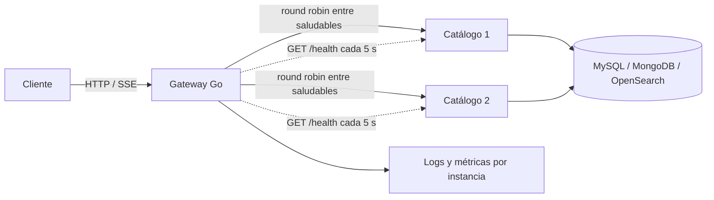

# ADR-012: Balanceo de carga

- **Estado:** Propuesta (versión inicial para la Entrega 2)
- **Fecha:** 2026-10-23
- **Decisión de la cátedra:** D12

## Contexto

El sistema debe ejecutar al menos un servicio con dos o más instancias y distribuir las solicitudes entre ellas. El balanceador debe evitar instancias enfermas y el API Gateway también debe validar JWT, proteger los headers de identidad, aplicar límites de solicitudes, y mantener SSE sin buffering. El estado de negocio vive en bases de datos compartidas por servicio, no en la memoria de una instancia.

## Decisión

### Servicio a escalar

Se escalará **Catálogo a dos instancias como mínimo**, detrás del API Gateway. Es el candidato de [docs/ARCHITECTURE.md](../ARCHITECTURE.md): concentra las consultas de ofertas, búsqueda y cambios de disponibilidad, además de retenciones y confirmaciones. Los datos viven en MongoDB, MySQL y OpenSearch; los bloqueos de cupo se realizan en MySQL en orden determinista (ADR-014), y los procesos concurrentes de vencimiento usan `SKIP LOCKED`. Las instancias no deben mantener estado de sesión local.

| Candidato | Evaluación |
|---|---|
| **Catálogo (elegido)** | Lectura y búsqueda intensivas, y lógica de cupos cuyo estado ya es compartido por bases externas. Es la opción más representativa para probar balanceo real. MySQL puede seguir siendo el límite bajo contención y se medirá. |
| Tiempo Real | Ya está diseñado para escalar sin estado: cada instancia recibe los eventos fanout y conserva sus conexiones SSE. Sin embargo, el SSE mantiene cada conexión ligada a una instancia, por lo que no demuestra por sí solo la distribución de solicitudes HTTP cortas. |
| Usuarios | Es un ABM más pequeño; su base ya es compartida, pero no es el candidato de mayor carga prevista. |
| Comprobantes | Puede ejecutarse en varias instancias gracias a MySQL y a la idempotencia, pero el límite por API Key de su API pública hoy es por instancia y la capacidad publicada no atraviesa este gateway. |

### API Gateway y distribución

Se propone un **gateway propio en Go** como único punto de entrada del frontend. Distribuirá requests de Catálogo mediante *round robin* entre las instancias saludables. Una conexión SSE permanece en la instancia elegida hasta que se cierre; las rutas SSE usan streaming, sin buffering, con timeouts largos y límite por conexiones abiertas. El gateway deberá:

1. Validar el JWT y obtener sus claims.
2. Eliminar siempre cualquier `X-Usuario-Id`, `X-Usuario-Email` y `X-Usuario-Rol` enviado por el cliente, y luego propagarlos desde los claims validados en las rutas protegidas.
3. Aplicar rate limiting por cliente/usuario, con tratamiento separado para conexiones SSE.
4. Ejecutar health checks activos contra `GET /health` de cada instancia de Catálogo.
5. No seleccionar instancias no saludables; conservar el streaming SSE sin buffering.

Como configuración inicial, consultar salud cada 5 segundos con timeout de 1 segundo; retirar una instancia del pool después de 3 fallas consecutivas y reincorporarla después de 2 respuestas saludables. Los valores se validarán con pruebas. Si una instancia cae, las solicitudes nuevas van a las instancias sanas; una solicitud en curso puede fallar y se recupera mediante el reintento del cliente si la operación es idempotente. No se migran conexiones SSE abiertas: el cliente reconecta y el gateway crea una nueva conexión.

La disponibilidad se comprueba con los health checks y con métricas/logs que identifiquen cada instancia. El tablero muestra solicitudes y latencias por instancia; durante una prueba se detiene una réplica, se verifica que deja de recibir solicitudes nuevas y que el tráfico se distribuye entre las restantes, y luego se observa su reincorporación.

### Evaluación de tecnología

| Alternativa | JWT e identidad | Health check y balanceo | SSE | Evaluación |
|---|---|---|---|---|
| **Traefik** | Middlewares para headers y rate limiting; validación JWT normalmente requiere `forwardAuth` o plugin. | Descubrimiento y health checks activos integrados; balanceo simple de configurar. | No bufferiza por defecto; requiere ajustar timeouts y límites. | Muy buen proxy, pero suma una dependencia para validar JWT e implementar nuestras reglas de identidad. |
| **Nginx** | JWT nativo disponible en NGINX Plus; en Open Source requiere módulo externo o servicio `auth_request`. | Balanceo maduro; los health checks activos completos dependen de Plus o de soluciones adicionales. | Soporta streaming si se desactiva buffering y se ajustan timeouts. | Robusto, pero las capacidades requeridas quedan repartidas entre edición, módulos y configuración. |
| **Gateway propio en Go (elegido)** | Valida el JWT con la lógica del sistema y elimina/propaga explícitamente los tres headers de identidad. | Permite implementar pool saludable, health checks activos y round robin con métricas por instancia. | Control directo de flush, buffering y límites de conexiones por ruta. | Alineado al stack y a las reglas específicas; implica construir, probar y mantener el proxy, el balanceador y sus políticas. |

## Diagrama

## Alternativas consideradas

- **Balanceo DNS o round robin sin health checks.** Puede seguir enviando tráfico a una instancia caída hasta que expire el caché DNS. Descartada.
- **Escalar primero Usuarios.** No concentra el flujo principal ni la carga esperada.
- **Elegir Traefik o Nginx como proxy sin gateway de autenticación separado.** No resuelve de forma directa y consistente la validación JWT más la eliminación/propagación de claims bajo los requisitos locales.

## Consecuencias

- (+) Catálogo escala horizontalmente sin replicar estado de negocio.
- (+) La caída de una instancia reduce capacidad, pero las demás siguen recibiendo solicitudes nuevas.
- (+) El gateway controla en un único lugar JWT, identidad, límites, salud, balanceo y SSE.
- (−) Hay que implementar y mantener un gateway propio; debe probarse especialmente ante fallos, sobrecarga y conexiones largas.
- (−) El balanceo no elimina la contención de MySQL en ofertas muy demandadas ni recupera una conexión SSE ya interrumpida.
- (−) Métricas por instancia, pruebas de caída y configuración de producción todavía están pendientes.

## Implementación

**Definido en esta propuesta:** Catálogo como servicio con dos o más instancias, algoritmo round robin, health checks activos, recuperación del pool y requisitos del gateway.

**Pendiente:** implementar el gateway, desplegar las réplicas de Catálogo, configurar métricas por instancia y validar umbrales con pruebas de carga y de caída.
