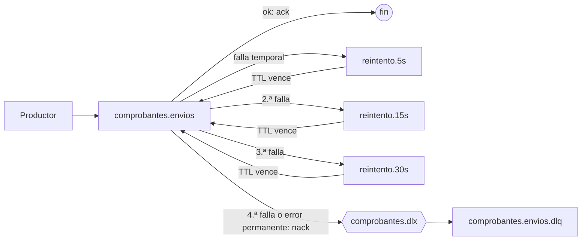

# Servicio Comprobantes

**Responsabilidad:** emisión de facturas en PDF y envío **siempre** por correo al email indicado. Implementa la **capacidad publicada** (contrato 1.0.2 en `docs/contracts/comprobantes/v1/`).

**Datos propios (MySQL, esquema `comprobantes`):** comprobantes (email, ítems, total), claves de idempotencia por consumidor, estado de envío (`PENDIENTE`, `ENVIADO`, `FALLIDO`) y outbox.

**Dependencias:**

| Dependencia | Tipo | Uso |
|---|---|---|
| MySQL | Almacenamiento | Comprobantes con clave única de idempotencia por consumidor, y outbox |
| RabbitMQ | Mensajería | Consume `CompraConfirmada` (con DLQ). Cola interna `comprobantes.envios` (con DLQ) para enviar los correos con reintentos |
| SMTP (Mailpit en local) | Externa | Envío de correos con PDF adjunto |

**Entradas:**

| Entrada | Datos | Consumidor | Idempotencia |
|---|---|---|---|
| Evento `CompraConfirmada` (uso interno) | `compraId`, `email`, `items` (`descripcion`, `precio`) | `interno` | Clave = `compraId` |
| `POST /v1/comprobantes` (uso externo, `X-API-Key`) | `email`, `items` (`descripcion`, `precio`) | El grupo dueño de la API Key | Header `Idempotency-Key`; misma clave y cuerpo → `200` sin reenviar correo; cuerpo distinto → `409` |
| `GET /v1/comprobantes/{id}` (uso externo) | — | El grupo dueño de la API Key | Solo devuelve comprobantes de ese consumidor; los demás responden `404` |

Las dos primeras entradas usan el mismo caso de uso: **emitir y encolar el envío**.

## Emisión

1. Valida el cuerpo según el contrato (`400`) y que el total sea mayor a cero (`422`).
2. Calcula el **hash SHA-256 del cuerpo normalizado** (se vuelve a serializar el JSON, así que espacios u orden de los campos no cambian el hash).
3. En **una sola transacción**: inserta el comprobante (`PENDIENTE`) con sus ítems y el evento `EnvioSolicitado` en el outbox.
4. Si la inserción choca con `UNIQUE (consumidor, idempotency_key)`, busca el comprobante existente: con el mismo hash responde `200` con ese comprobante (sin reenviar el correo); con otro hash, `409`.

La clave de idempotencia es **por consumidor**: dos grupos pueden usar la misma clave sin chocar, y un `compraId` interno nunca se confunde con la clave de un grupo externo.

## Envío del correo

- Un **publicador de outbox** lleva `EnvioSolicitado` a la cola `comprobantes.envios`. Si el servicio se cae después del commit, el evento sigue en el outbox y se publica al volver: un comprobante nunca queda `PENDIENTE` para siempre.
- El **worker de envío** consume la cola: si el comprobante ya está `ENVIADO`, confirma el mensaje sin enviar nada; si no, genera el PDF, lo envía por SMTP y marca `ENVIADO`.
- Si el envío falla: hasta 3 reintentos con espera creciente. Al agotarlos, marca `FALLIDO` y el mensaje pasa a `comprobantes.envios.dlq`. El comprobante **sigue emitido**.

## Reglas de la API pública

- **Autenticación:** `X-API-Key`. Las claves válidas se configuran en `COMPROBANTES_API_KEYS` con el formato `grupo:clave,grupo:clave`. En la base se guarda el nombre del grupo (`consumidor`), nunca la clave.
- **Timeout contra MySQL:** cada solicitud espera a la base como máximo 2 segundos ([ADR-010](../../docs/adr/ADR-010-resiliencia.md)). Si MySQL está caído o lento, responde `503` con `Retry-After` y el consumidor reintenta con la misma `Idempotency-Key`. Cuando la base vuelve, el servicio se recupera solo. `GET /health` responde `503` mientras la base no responda.
- **Importe máximo:** ningún precio ni el total pueden superar `9999999999.99` (el máximo de `DECIMAL(12,2)`); si no, `422`.
- **Límite de solicitudes:** 60 por minuto por API Key, controlado por el propio servicio, porque esta API **no pasa por el gateway** ([ADR-008](../../docs/adr/ADR-008-contrato-propio.md)). Al superarlo responde `429` con `Retry-After`.
- **Importes:** se guardan como `DECIMAL(12,2)` (nunca como punto flotante), así las sumas no acumulan errores de redondeo. Un precio con más de 2 decimales **se redondea** a 2 (al más cercano; el 5 redondea hacia arriba: `10.005` → `10.01`). Primero se redondea cada ítem y después se suma el total, así el total siempre coincide con la suma de los ítems que se devuelven. El hash de idempotencia se calcula sobre el cuerpo **original**, antes de redondear. Si después de redondear el total queda en cero (por ejemplo, un único ítem de `0.004`), responde `422`.

## Modelo de datos

```
comprobantes(id UUID PK, nro BIGINT AUTO_INCREMENT UNIQUE, consumidor, idempotency_key,
             hash_solicitud, email, total DECIMAL(12,2), estado_envio, intentos_envio,
             fecha_emision, actualizado_en,
             UNIQUE (consumidor, idempotency_key))
items_comprobante(comprobante_id FK, orden, descripcion, precio DECIMAL(12,2),
                  PK (comprobante_id, orden))
outbox(id PK, tipo, payload JSON, creado_en, publicado_en NULL)
```

`numero` (por ejemplo `B-0001-00000042`) se arma a partir de `nro`.

## Estructura (Go, arquitectura hexagonal)

El dominio y los casos de uso no conocen HTTP, RabbitMQ, MySQL ni SMTP: dependen de **puertos** (interfaces) que implementan los **adaptadores**. Las dos entradas (API y evento) son adaptadores que llaman al mismo caso de uso. Justificación en [ADR-002](../../docs/adr/ADR-002-arquitectura-interna.md).

```
cmd/comprobantes/main.go     # arma las dependencias y arranca la API, los consumidores y el publicador de outbox
cmd/comprobantes/config.go   # configuración por variables de entorno
internal/domain/             # Comprobante, Item, EstadoEnvio; reglas: redondeo, total > 0, transiciones de estado
internal/application/        # casos de uso: EmitirComprobante, ObtenerComprobante, EnviarComprobante
internal/ports/              # interfaces: RepositorioComprobantes, GeneradorPDF, Mailer, Outbox
internal/adapters/api/       # entrada: API pública v1 (Gin), API Key, rate limit, problem+json
internal/adapters/rabbit/    # entrada: consumidores de CompraConfirmada y comprobantes.envios; salida: publicador de outbox
internal/adapters/mysql/     # salida: comprobantes, ítems y outbox (GORM)
internal/adapters/pdf/       # salida: generación del PDF
internal/adapters/smtp/      # salida: envío de correo (Mailpit en local)
arquitectura_test.go         # verifica que domain, ports y application no importen infraestructura
```

El adaptador HTTP se llama `api` y no `http` para no chocar con el paquete `net/http` de Go.

## Colas (RabbitMQ)

Implementación en `internal/adapters/rabbit`. Cada componente (consumidor de compras, worker de envíos y publicador de outbox) declara la topología completa al conectarse. La declaración es idempotente: volver a declarar una cola con los mismos argumentos no cambia nada.

### Topología

| Nombre | Tipo | Argumentos | Para qué |
|---|---|---|---|
| `comprobantes.compras` | Cola durable | DLX `comprobantes.dlx`, routing key `comprobantes.compras.dlq` | Recibe `CompraConfirmada` de Reservas |
| `comprobantes.envios` | Cola durable | DLX `comprobantes.dlx`, routing key `comprobantes.envios.dlq` | Recibe `EnvioSolicitado` desde nuestro outbox |
| `comprobantes.dlx` | Exchange `direct` durable | — | Enruta a la DLQ los mensajes rechazados (`nack` sin requeue) |
| `comprobantes.compras.dlq`, `comprobantes.envios.dlq` | Colas durables | — | Mensajes que no se pudieron procesar, para análisis y reprocesamiento manual |
| `<cola>.reintento.5s`, `.15s`, `.30s` | Colas durables, sin consumidores | `x-message-ttl` = la espera; DLX = exchange por defecto, routing key = `<cola>` | Espera antes de cada reintento |



### Reintentos con espera creciente

Un error temporal se reintenta hasta `MaxIntentos` = 3 veces, con esperas de 5, 15 y 30 segundos (`rabbit.EsperasReintento`). En total son 4 intentos en unos 50 segundos, más lo que tarde cada intento (el envío SMTP corta a los 10 s).

1. Si el procesamiento falla con un error temporal, el consumidor **publica una copia** del mensaje en la cola de reintento que corresponde (con publisher confirms), con el header `x-intentos` incrementado. **Después** hace `ack` del original. Si el servicio cae entre los dos pasos, el mensaje queda duplicado, nunca perdido, y los consumidores son idempotentes.
2. La cola de reintento no tiene consumidores. Cuando vence el TTL, RabbitMQ la devuelve a la cola original por dead-lettering.
3. Si `x-intentos` ya llegó a 3, el consumidor hace `nack` sin requeue y el DLX lleva el mensaje a la `.dlq`, con sus headers (`x-intentos`, `X-Correlation-Id` y el `x-death` que agrega RabbitMQ).

Por qué este mecanismo:

- **`nack` con requeue:** reintenta enseguida, sin espera, y en colas clásicas no cuenta los intentos. Descartado.
- **Esperar dentro del consumidor (`sleep`):** ocupa un lugar del prefetch mientras espera. Además, si el servicio se reinicia, la espera y la cuenta de intentos se pierden. Descartado.
- **Una sola cola de reintento con TTL por mensaje:** RabbitMQ solo vence los mensajes que están en la cabeza de la cola, así que uno con espera larga traba a los de espera corta. Por eso hay **una cola por espera**, con el TTL fijo en la cola.
- **Plugin `rabbitmq_delayed_message_exchange`:** necesita una imagen de RabbitMQ con el plugin instalado. Las colas con TTL usan solo funciones estándar.

El nombre de cada cola de reintento incluye su espera. Si se cambian las esperas, se declaran colas nuevas en lugar de chocar con los argumentos de las anteriores (RabbitMQ rechaza redeclarar una cola con otros argumentos: `PRECONDITION_FAILED`).

### Clasificación de errores

| Cola | Error | Qué se hace |
|---|---|---|
| `comprobantes.envios` | Envío correcto, o comprobante ya `ENVIADO` | `ack` |
| | Cuerpo mal formado (sin `comprobanteId`) o comprobante inexistente | DLQ directa |
| | Cualquier otro error (SMTP caído, timeout, base de datos) | Reintento. Al agotarlos, `MarcarFallido` y DLQ. Si no se puede guardar `FALLIDO`, se sigue reintentando con la última espera, para que el comprobante no quede `PENDIENTE` para siempre |
| `comprobantes.compras` | Comprobante emitido, o duplicado (`YaExistia`) | `ack` |
| | JSON inválido, `compraId` que no es UUID, email inválido, ítem sin `descripcion` (1 a 200 caracteres) o sin `precio` | DLQ directa |
| | Regla de dominio incumplida (`ErrSinItems`, `ErrPrecioNegativo`, `ErrTotalCero`, `ErrImporteFueraDeRango`) o mismo `compraId` con otro contenido (`ErrConflictoIdempotencia`) | DLQ directa |
| | Cualquier otro error (base de datos) | Reintento; al agotarlos, DLQ |

Para reprocesar un mensaje de una DLQ, se mueve a la cola original **sin** el header `x-intentos`. Por ejemplo, desde la consola: *Get messages* en la DLQ y *Publish message* en la cola original.

### Mensajes

**`CompraConfirmada`** (cola `comprobantes.compras`, publicada por Reservas por el exchange por defecto, persistente, `content-type: application/json`):

```json
{
  "eventId": "0d8c3d64-5f0e-4d5e-9a57-7a0f2b3c4d5e",
  "compraId": "6b0c1d2e-3f40-4a5b-8c6d-7e8f90a1b2c3",
  "email": "ana.perez@example.com",
  "items": [
    { "descripcion": "Pasaje Córdoba - Bariloche", "precio": 1234.5 }
  ]
}
```

| Campo | Reglas |
|---|---|
| `eventId` | UUID del evento. Se registra en los logs; la idempotencia la da `compraId` |
| `compraId` | UUID, obligatorio. Es la `IdempotencyKey` del comprobante (consumidor `interno`): el mismo `compraId` dos veces genera un solo comprobante y un solo correo |
| `email` | Obligatorio, del JWT del cliente, guardado en la compra |
| `items[].descripcion` | Entre 1 y 200 caracteres |
| `items[].precio` | Número en ARS, `>= 0`. Se lee como decimal exacto, sin pasar por punto flotante, y se redondea a 2 decimales como en la API |

Headers: `X-Correlation-Id` (opcional) con la correlación de la solicitud que originó la compra. Los campos desconocidos se ignoran, para que Reservas pueda agregar campos sin romper el consumidor.

**`EnvioSolicitado`** (cola `comprobantes.envios`, interno): `{"comprobanteId": "<uuid>"}`. Lo publica el publicador de outbox con `type: EnvioSolicitado`, `message-id: outbox-<id>` y los headers guardados en el outbox (`X-Correlation-Id` de la solicitud HTTP o del evento que originó el comprobante). Así los logs del worker llevan el mismo `correlacion_id` que la solicitud original.

### Publicador de outbox

Cada 1 segundo lee hasta 50 eventos pendientes y publica cada uno como mensaje persistente en un canal con **publisher confirms**. Lo marca publicado **solo después** de que el broker lo confirma. Si el broker no confirma, el evento sigue pendiente y se reintenta después de reconectar. Si la base no responde, lo registra (una vez por cada error distinto) y prueba de nuevo en el próximo ciclo, sin cortar la conexión con RabbitMQ. Un evento publicado que no se pudo marcar se vuelve a publicar más tarde; el worker lo tolera porque no reenvía un comprobante ya `ENVIADO`.

### Conexión, consumo y apagado

- Si RabbitMQ no está disponible al arrancar, o si se cae la conexión, cada componente lo registra (`no se pudo conectar a RabbitMQ` / `se perdió la conexión con RabbitMQ`) y reconecta con backoff exponencial: de 1 s hasta 30 s, con ±20 % de jitter. El servicio (API incluida) sigue funcionando mientras tanto.
- Los consumidores usan `prefetch` = 5 y procesan hasta 5 mensajes en paralelo. El `ack` se hace solo después de procesar.
- Al apagar, los consumidores dejan de recibir mensajes y terminan los que están en curso (hasta 30 s). Los mensajes entregados y todavía sin `ack` vuelven a la cola.
- Cada mensaje se procesa con `observabilidad.ProcesarMensaje`, que recupera la correlación (y la traza, cuando esté implementada) de los headers.

### Cómo probarlo

```bash
go test ./...          # unitarios: adaptadores con dobles, sin Docker
go test -short ./...   # saltea el test de integración
```

El test de integración de `internal/adapters/rabbit` levanta RabbitMQ con testcontainers-go (necesita Docker; si Docker no está disponible, se saltea solo). Prueba el outbox, los 4 intentos, `FALLIDO` y la DLQ con esperas acortadas.

En el entorno completo (`docker compose up -d --build`):

- Correo: Mailpit en http://localhost:8025. Colas: consola de RabbitMQ en http://localhost:15672 (usuario y contraseña de `.env`).
- Fallo de envío: `docker compose stop mailpit`, emitir un comprobante y esperar unos 50 s. El `GET` muestra `FALLIDO` y el mensaje queda en `comprobantes.envios.dlq`.
- `CompraConfirmada` a mano: en la consola, cola `comprobantes.compras` → *Publish message*, con *Delivery mode* 2 (persistente), el header `content_type` = `application/json` y el JSON de ejemplo. Publicarlo dos veces genera un solo comprobante.

## Estado de la implementación

| Parte | Estado |
|---|---|
| Dominio y casos de uso | Implementados, con tests unitarios |
| Conexión a MySQL, esquema (GORM `AutoMigrate`) y `GET /health` | Implementados |
| Repositorio MySQL con outbox | Implementado, con tests de integración contra MySQL real (testcontainers; `go test -short` los saltea) |
| API pública v1 (`POST` y `GET`), API Key y rate limit | Implementados según el contrato 1.0.2, con tests de cada respuesta (201, 200, 400, 401, 404, 409, 422, 429, 503) |
| Consumidor de `CompraConfirmada`, worker de envíos, publicador de outbox, PDF y SMTP | Pendiente: buscar `TODO(rabbit)` |
| Trazas con OpenTelemetry | Pendiente: `TODO(observabilidad)` en `pkg/observabilidad` |

## Cómo correrlo

```bash
docker compose up -d --build comprobantes   # desde la raíz: levanta también MySQL, RabbitMQ y Mailpit
curl http://localhost:8081/health

go test ./...                                # desde services/comprobantes: tests unitarios y de arquitectura
```

**Historial:**
- 2026-10-22: el contrato pasa a 1.0.0 (solo `email` e `items`, envío siempre por correo, sin descarga de PDF por API) ([ADR-008](../../docs/adr/ADR-008-contrato-propio.md)).
- 2026-10-22: idempotencia por consumidor con hash del cuerpo, outbox para el envío, importes `DECIMAL`, rate limit propio y estructura hexagonal ([ADR-002](../../docs/adr/ADR-002-arquitectura-interna.md), [ADR-005](../../docs/adr/ADR-005-comunicacion-entre-servicios.md#revisiones), [ADR-008](../../docs/adr/ADR-008-contrato-propio.md#revisiones)).
