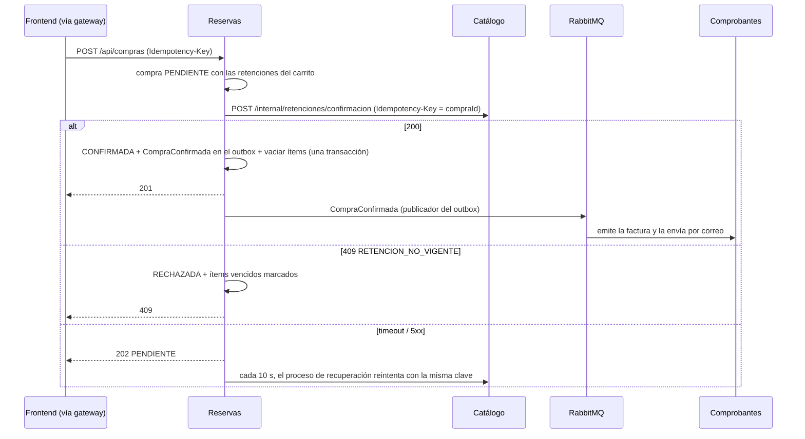

# Servicio Reservas

**Responsabilidad:** carrito, confirmación de compras y estados de compra (`PENDIENTE`, `CONFIRMADA`, `RECHAZADA`), y las **guías de viaje** que comparten los clientes (HU-13). Coordina la operación crítica: le pide a Catálogo retener cupo al agregar al carrito y confirmar las retenciones al comprar, y registra el resultado. **No guarda cupos**: los cupos y las retenciones son de Catálogo ([ADR-014](../../docs/adr/ADR-014-cupos-en-catalogo-con-retencion.md)).

**Datos propios (MySQL, esquema `reservas`):**
- Ítems del carrito: cada uno con sus `retencionId` y `expiraEn`. Un pack tiene una retención por opción.
- Compras, con el email del cliente, y sus líneas con el precio cobrado.
- Guías compartidas, con su PDF hasta que Estudiario las acepta.
- Outbox de eventos.
- `app_logs`, los logs persistidos ([ADR-011](../../docs/adr/ADR-011-observabilidad.md)).

**Identidad del cliente:** el gateway valida el JWT y completa los headers `X-Usuario-Id` y `X-Usuario-Email`. Reservas confía en esos headers y no valida el token. El email se guarda en la compra al crearla, así el evento `CompraConfirmada` y la recuperación de compras pendientes no dependen de Usuarios.

## Dependencias

| Dependencia | Tipo | Uso | Si falla |
|---|---|---|---|
| MySQL | Almacenamiento | Carrito, compras, guías y outbox | `503` con `Retry-After`; `/health` responde `503` |
| Catálogo (API interna) | REST síncrono, [contrato interno](../../docs/contracts/internos/catalogo-retenciones.yaml) | Retener, liberar y confirmar cupos. Timeout de 2 s por intento, hasta 2 reintentos (200 y 400 ms, con jitter). Los `409` y `422` de negocio no se reintentan | Agregar: `503` "no pudimos reservar tu lugar", y el ítem no se agrega. Quitar: el ítem se quita igual y la retención vence sola. Comprar: `202 PENDIENTE` y lo resuelve el proceso de recuperación |
| RabbitMQ | Mensajería | Publica `CompraConfirmada` (outbox) en `comprobantes.compras`. Consume `RetencionVencida` del fanout `catalogo.disponibilidad` (cola `reservas.retenciones`, con reintentos y DLQ) | Los eventos esperan en el outbox y se publican al reconectar; los componentes reconectan con backoff sin tirar abajo el servicio |
| Estudiario (Grupo 2) | REST síncrono, [contrato fijado 1.0.0](../../docs/contracts/consumidos/estudiario/1.0.0/documents-v1.yaml) | Registrar las guías y seguir su moderación ([ADR-009](../../docs/adr/ADR-009-consumo-del-proveedor.md)) | No imprescindible: la guía queda `POR_ENVIAR` y se reenvía sola. Circuit breaker después de 5 fallas seguidas |

## API (la usa el frontend a través del gateway)

Todas las rutas llevan el prefijo `/api`, así el gateway enruta por prefijo sin reescribir. Todas exigen `X-Usuario-Id`; sin él, `401`. Los errores siguen el formato `application/problem+json`, con un `code` estable para decidir qué mostrar.

| Método y ruta | Qué hace | Respuestas |
|---|---|---|
| `GET /api/carrito` | Ítems con su estado (`ACTIVO`, o `VENCIDO` si pasó `expiraEn`) y el total de referencia | `200` |
| `POST /api/carrito/items` `{ofertaId, cantidad}` o `{packId, opciones, cantidad}`. `Idempotency-Key` opcional | Retiene el cupo y agrega el ítem. Con la misma clave devuelve el mismo ítem | `201` · `200` (repetido) · `400` · `409 sin-cupo` (con `estado` `AGOTADA`/`RETENIDA` y `proximaLiberacion`) · `422 regla-incumplida` · `503` |
| `DELETE /api/carrito/items/{id}` | Quita el ítem y libera el cupo | `204` · `404` |
| `POST /api/compras`. `Idempotency-Key` **obligatoria** (una por intento de compra) | Confirma todo el carrito | `201 CONFIRMADA` · `202 PENDIENTE` (consultar `Location`) · `409 RECHAZADA` (con `retencionesVencidas`) · `200` (misma clave: la compra ya creada) · `422 carrito-vacio` |
| `GET /api/compras` · `GET /api/compras/{id}` | Mis compras | `200` · `404` (las de otro usuario no se ven) |
| `POST /api/guias` (multipart: `titulo`, `destino`, `autor`, `descripcion`, `etiquetas` separadas por coma, `archivo` PDF ≤ 10 MB) | Comparte una guía de un destino **comprado** | `202` (con estado `PENDIENTE`, `POR_ENVIAR` o `RECHAZADA`) · `400` · `403 destino-no-comprado` · `413` · `415` |
| `GET /api/guias` | Mis guías y su estado | `200` |
| `GET /health` · `GET /metrics` | Salud (MySQL) y métricas Prometheus | — |

Importes: número JSON con 2 decimales, en ARS. Ejemplos de cada respuesta en los tests de `internal/adapters/api`.

## Compra (ADR-014)



- **Sin duplicados:** la misma `Idempotency-Key` devuelve la compra ya creada. Si la solicitud y el proceso de recuperación resuelven la misma compra a la vez, la actualización condicionada a `estado = PENDIENTE` hace que solo uno escriba el outbox; el test de integración lo verifica con 5 resoluciones en paralelo.
- **Siempre termina:** como máximo cuando vencen las retenciones, Catálogo responde `409` y la compra queda `RECHAZADA`.

## Guías de viaje (HU-13, ADR-009)

1. El cliente sube la guía. Reservas valida las reglas del contrato de Estudiario (título, autor, etiquetas, PDF ≤ 10 MB) y que tenga una compra `CONFIRMADA` de ese destino, sin distinguir mayúsculas ni acentos.
2. Se guarda `POR_ENVIAR` con su PDF y una `Idempotency-Key` propia, y se intenta enviar en el momento.
3. Si Estudiario no responde, cada 30 s se reintenta con la **misma** clave (`GUIAS_ENVIO_INTERVALO`), 5 por ciclo, por el cupo de 10 registros por minuto.
4. Una vez aceptada queda `PENDIENTE` y se borra el PDF. Cada 5 minutos (`GUIAS_MODERACION_INTERVALO`) se consulta `GET /v1/submissions` y la guía pasa a `PUBLICADA` o `RECHAZADA`, con el motivo.

## Estructura (Go, arquitectura hexagonal, [ADR-002](../../docs/adr/ADR-002-arquitectura-interna.md))

```
cmd/reservas/                  # main (armado) y config (variables de entorno)
internal/domain/               # Carrito, ItemCarrito, Compra, Guia y sus reglas
internal/application/          # casos de uso: Carritos, Compras (incl. recuperación), Guias
internal/ports/                # RetencionesCatalogo, RepositorioCarritos/Compras/Guias, GuiasExternas
internal/adapters/api/         # entrada HTTP (Gin)
internal/adapters/mysql/       # repositorios y outbox (GORM), reintento de conexión al arrancar
internal/adapters/catalogo/    # cliente de la API interna con timeout y reintentos
internal/adapters/estudiario/  # traduce pkg/estudiario al puerto GuiasExternas
internal/adapters/rabbit/      # publicador del outbox y consumidor de RetencionVencida (pkg/mensajeria)
arquitectura_test.go           # domain, ports y application no importan infraestructura
```

Compartido en `pkg/`: `mensajeria` (reconexión, outbox, reintentos con DLQ) y `estudiario` (adaptador del proveedor con circuit breaker), que también puede usar Catálogo.

## Configuración

| Variable | Por defecto | Qué es |
|---|---|---|
| `DB_PASSWORD` | — (obligatoria) | `RESERVAS_DB_PASSWORD` del `.env` |
| `RABBITMQ_URL` | — (obligatoria) | |
| `CATALOGO_URL` | `http://catalogo:8080` (en compose: `catalogo-mock`) | API interna de Catálogo |
| `ESTUDIARIO_URL` | `http://estudiario-mock:4010` | URL de Estudiario en la nube (en el `.env`); sin ella, su mock |
| `ESTUDIARIO_API_KEY` | vacía (en compose: una clave para el mock) | La entrega el Grupo 2 por privado. Va en `.env` |
| `RECUPERACION_COMPRAS_INTERVALO` · `GUIAS_ENVIO_INTERVALO` · `GUIAS_MODERACION_INTERVALO` | `10s` · `30s` · `5m` | Procesos periódicos |

## Cómo correrlo y probarlo

```bash
docker compose up -d --build reservas    # desde la raíz; levanta MySQL, RabbitMQ y los mocks
curl http://localhost:8082/health

go test -short ./...                     # desde services/reservas: unitarios, API y arquitectura
go test ./...                            # + integración contra MySQL y RabbitMQ reales (testcontainers, necesita Docker)
```

Mientras Catálogo no esté en el compose, Reservas usa `catalogo-mock` (Prism con el contrato interno, que responde siempre los ejemplos) y `estudiario-mock` (el contrato del proveedor). Para probar sin gateway, mandá los headers a mano:

```bash
curl -X POST localhost:8082/api/carrito/items -H "X-Usuario-Id: u1" -H "X-Usuario-Email: ana@example.com" \
  -H "Content-Type: application/json" -d '{"ofertaId":"of-vuelo-bariloche-0712","cantidad":2}'
curl -X POST localhost:8082/api/compras -H "X-Usuario-Id: u1" -H "X-Usuario-Email: ana@example.com" -H "Idempotency-Key: compra-0001"
```

La compra confirmada publica `CompraConfirmada` y Comprobantes envía la factura al email del header: con Gmail configurado en `.env`, es un correo real.

**Probado de punta a punta el 2026-11-07** (Docker, con los mocks):
- Carrito y compra `CONFIRMADA`: el comprobante se emitió y se envió con el mismo `correlacion_id` en los logs de Reservas y de Comprobantes.
- Guía de un destino no comprado: `403`.
- Guía con la API Key de Estudiario ausente: quedó `POR_ENVIAR`; al configurar la clave, se envió sola en el ciclo siguiente.
- Catálogo detenido durante la compra: `202 PENDIENTE`, y `CONFIRMADA` sola a los 17 s de volver Catálogo.
- Agregar al carrito sin Catálogo: `503`.

**Historial:**
- 2026-10-22: deja de guardar cupos (pasan a Catálogo), retiene al agregar al carrito y confirma retenciones al comprar; estado `PENDIENTE` con recuperación ([ADR-014](../../docs/adr/ADR-014-cupos-en-catalogo-con-retencion.md)). El email del cliente sale del header `X-Usuario-Email`.
- 2026-11-07: implementación del servicio y de las guías de viaje con Estudiario ([ADR-009](../../docs/adr/ADR-009-consumo-del-proveedor.md)).
